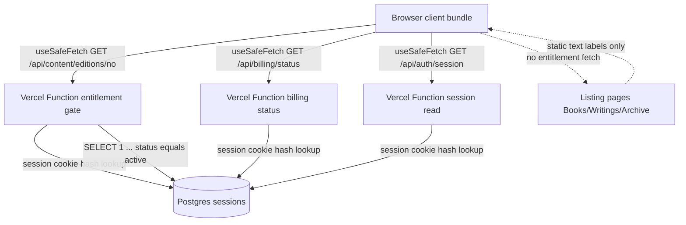

<objective>
Deliver the client half of real server-side entitlement: the Edition page's gated block rewritten onto a server-backed hook (useGatedContent + useSafeFetch, folding the Phase 3 IN-03 refetch-safety fix), the free-only excerpt restored to content.js in the D-11-compatible way with the check-secrets marker re-targeted, and the GATE-02 demo-state cleanup (store.jsx, Account.jsx, listing labels) that removes every client-trusted subscription flag. This wave makes the not-entitled view render exactly as it does today (GATE-05), adds the silent skeleton pending state (D-12), confines the --bad reload guidance to the signed-in fetch-failure case (04-UI-SPEC), and proves via build-level grep that gated text stays physically absent from the client bundle.
</objective>

## Artifacts This Phase Produces (Plan 04-02)

- **Files created:** `src/lib/useSafeFetch.js`, `src/lib/useGatedContent.js`
- **Files modified:** `src/lib/useEntitlements.js` (backport onto useSafeFetch), `src/data/content.js` (free-only excerpt restore), `scripts/check-secrets.js` (marker re-target), `src/routes/Edition.jsx` (gated block rewrite), `src/store.jsx` (demo state removed), `src/routes/Account.jsx` (real entitlement + Reset-demo-state deleted), `src/routes/Books.jsx` / `src/routes/Writings.jsx` / `src/routes/Archive.jsx` (static labels)
- **Endpoint paths consumed:** `GET /api/content/editions/:no` (Wave 1, D-15 contract), `GET /api/billing/status` (existing), `GET /api/auth/session` (existing)
- **Client data:** `src/lib/useSafeFetch.js` (shared fetch primitive), `src/lib/useGatedContent.js` (edition gated-block hook), `src/lib/useEntitlements.js` (backported, IN-03 fix)
- **Routes touched:** none added/removed — `/editions/:no` stays prerendered (D-10)
- **CSS additions:** none — reuses existing `.plan__skeleton` (eclat.css lines 1394-1401) and the existing paywall classes verbatim (GATE-05)
- **Requirement IDs advanced:** GATE-02 (demo state removed), GATE-05 (not-entitled renders exactly as today); D-07..D-14/D-17 implemented client-side

<execution_context>
@$HOME/.claude/gsd-core/workflows/execute-plan.md
@$HOME/.claude/gsd-core/templates/summary.md
</execution_context>

<context>
@.planning/PROJECT.md
@.planning/ROADMAP.md
@.planning/REQUIREMENTS.md
@.planning/phases/04-content-gating-real-server-side-entitlement-enforcement/04-CONTEXT.md
@.planning/phases/04-content-gating-real-server-side-entitlement-enforcement/04-RESEARCH.md
@.planning/phases/04-content-gating-real-server-side-entitlement-enforcement/04-UI-SPEC.md
@.planning/phases/04-content-gating-real-server-side-entitlement-enforcement/04-01-PLAN.md
@.planning/phases/04-content-gating-real-server-side-entitlement-enforcement/04-DISCUSSION-LOG.md
@src/lib/useEntitlements.js
@src/lib/useSession.js
@src/store.jsx
@src/routes/Edition.jsx
@src/routes/Account.jsx
@src/routes/Books.jsx
@src/routes/Writings.jsx
@src/routes/Archive.jsx
@src/data/content.js
@scripts/check-secrets.js
@src/styles/eclat.css
@api/billing/status.js
@lib/gated-content.js
</context>

<tasks>

<task type="auto" tdd="false">
  <name>Task 1: Create src/lib/useSafeFetch.js — the shared abort-cancel fetch primitive (D-07..D-09, folds Phase 3 IN-03)</name>
  <precondition>Plan 04-01 is complete: api/content/editions.js, lib/gated-content.js, lib/session-user.js, and the vercel.json rule all exist; the check-secrets marker is still 'the work of decades, not quarters' (Task 4 of this wave re-targets it).</precondition>
  <reversibility rating="cheap">Pure additive leaf module. Nothing consumes it until Tasks 2-3 import it; deleting it leaves the app exactly as Wave 1 left it.</reversibility>
  <read_first>src/lib/useEntitlements.js (the current hook to backport — its shape and its IN-03 hazard), src/lib/useSession.js (the cancel-flag idiom this primitive replaces), .planning/phases/04-content-gating-real-server-side-entitlement-enforcement/04-RESEARCH.md (Example 1 lines 263-303 — the reference implementation; D-07..D-09 in user_constraints), .planning/phases/04-content-gating-real-server-side-entitlement-enforcement/04-01-PLAN.md (Task 1's D-15 contract and Task 3's Cache-Control decision — the endpoint this hook feeds in Task 3), .planning/phases/04-content-gating-real-server-side-entitlement-enforcement/04-UI-SPEC.md (Copywriting Contract loading/error rows — the hook's error surface drives the --bad copy in Task 5).</read_first>
    <files>src/lib/useSafeFetch.js (create — new leaf module, no existing file)</files>
    <action>
      - Create src/lib/useSafeFetch.js exporting a named `useSafeFetch(url, { enabled = true, key = 0 } = {})` returning `{ loading, data, error }`.
      - State: `useState(null)` for data, `useState(enabled)` for loading, `useState(false)` for error.
      - Refs: `abortRef = useRef(null)` and `idRef = useRef(0)` — a monotonic request id so a stale response can never overwrite a newer one (D-08 latest-request-wins).
      - Effect `useEffect(() => { ... }, [url, enabled, key])`:
        1. `if (!enabled) return` — a disabled hook stays idle with `loading: false`.
        2. `const id = ++idRef.current`; `abortRef.current?.abort()`; `const ctrl = new AbortController()`; `abortRef.current = ctrl`; `setLoading(true)`.
        3. `fetch(url, { signal: ctrl.signal, credentials: 'same-origin' }).then((r) => r.json()).then((body) => { if (id !== idRef.current) return; setData(body); setError(false); setLoading(false); })`.
        4. `.catch((err) => { if (err.name === 'AbortError' || id !== idRef.current) return; setData(null); setError(true); setLoading(false); })` — an abort-by-newer-request must NOT surface as an error.
        5. Cleanup: `return () => ctrl.abort()` — unmount and key-bump both abort the in-flight request; the effect owns the abort, so no caller cleanup is ever returned (this is the IN-03 fix).
      - The `key` dependency IS the refetch mechanism: a caller bumps `key` to abort-and-rerun; because the effect owns the abort, a manual refetch is always safe.
      - No default export; no new dependencies (plain React hooks only); never import anything from `lib/` or `api/` (SERVER-ONLY boundary, Phase 3 WR-10).
    </action>
    <verify>
      <automated>`npm run build` succeeds with the new module present and unimported (proves it parses and bundles); `node --check src/lib/useSafeFetch.js` passes.</automated>
      <human-check>Reviewer confirms: abort-by-newer-request does not set error:true, and the effect cleanup aborts on unmount — the IN-03 hazard is structurally impossible.</human-check>
    </verify>
    <acceptance_criteria>
      - src/lib/useSafeFetch.js exports useSafeFetch with the exact signature above and abort/latest-wins semantics (D-07..D-09).
      - No caller-returned cleanup exists anywhere in the codebase after this task; refetch = key bump only.
      - Build green; zero new packages; no server-only imports (scripts/check-secrets.js still passes).
    </acceptance_criteria>
    <done>✅ Task 1 — src/lib/useSafeFetch.js created; abort-cancel primitive verified; build green.</done>
  </task>
  
  <task type="auto" tdd="false">
    <name>Task 2: Backport src/lib/useEntitlements.js onto useSafeFetch — fixes Phase 3 IN-03 (D-07..D-09)</name>
    <precondition>Task 1 complete: useSafeFetch exists and builds. Wave 1 left api/billing/status.js unchanged (existing endpoint).</precondition>
    <reversibility rating="cheap">useEntitlements already exists; this is a same-shape internal rewrite. Its two consumers (Subscribe.jsx picker, SubscribeSuccess.jsx polling) must keep working identically; reverting to the cancel-flag body restores the old behavior.</reversibility>
    <read_first>src/lib/useEntitlements.js (current body to replace — 46 lines), src/routes/Subscribe.jsx (consumer — how subs/loading/error/refetch drive the per-product picker), src/routes/SubscribeSuccess.jsx (consumer — the polling loop at lines 39-59), api/billing/status.js (response shape: { subscriptions: { [key]: { status, current_period_end } } }, 401 with { subscriptions: {} }), .planning/phases/04-content-gating-real-server-side-entitlement-enforcement/04-RESEARCH.md (Example 3 lines 330-345 — the backported reference).</read_first>
    <files>src/lib/useEntitlements.js (rewrite — same file, new body)</files>
    <action>
      - Replace the cancel-flag body with: `const [key, setKey] = useState(0)`; `const { loading, data, error } = useSafeFetch('/api/billing/status', { enabled: true, key })`; `const subs = (data && data.subscriptions) || {}`; `const refetch = useCallback(() => setKey((k) => k + 1), [])`.
      - Import `useSafeFetch` from './useSafeFetch.js'; drop the now-unused `fetch`, `cancelled`, and `useEffect` usage (keep `useCallback`, `useState` as needed).
      - Return `{ subs, loading, error, refetch }` — identical shape; the two consumers require zero changes (D-04 fail-closed: api/billing/status returns { subscriptions: {} } on 401/DB-error, and the `|| {}` guard covers the parse-failure case).
    </action>
    <verify>
      <automated>`npm run build` green; `grep -rn "fetch(" src/lib/useEntitlements.js` returns nothing; `grep -rn "cancelled" src/lib/useEntitlements.js` returns nothing; `node --check src/lib/useEntitlements.js` passes.</automated>
      <human-check>Signed-in active subscriber: /subscribe picker shows 'Subscribed' on eclat-online; /subscribe/success polling transitions to Active after checkout; signed-out: picker shows 'Subscribe' (401 → {} → not subscribed, D-04).</human-check>
    </verify>
    <acceptance_criteria>
      - Identical { subs, loading, error, refetch } contract; IN-03 orphaned-cleanup hazard eliminated (refetch is a key bump, abort owned by useSafeFetch).
      - Fails closed to { subs: {} } on 401/network/parse error exactly as today.
      - Build green; check-secrets.js still passes (no server-only import added).
    </acceptance_criteria>
    <done>✅ Task 2 — useEntitlements backported onto useSafeFetch; IN-03 fixed; consumers unchanged.</done>
  </task>
  
  <task type="auto" tdd="false">
    <name>Task 3: Create src/lib/useGatedContent.js — the Edition gated-block hook (D-10..D-13, D-15, D-17)</name>
    <precondition>Tasks 1-2 complete: useSafeFetch exists; Wave 1 shipped GET /api/content/editions/:no returning exactly the D-15 contract (200 {entitled:true, content:{paragraphs:[...]}} | 200 {entitled:false, has_session:true} | 401 {entitled:false, has_session:false} | 404, all with Cache-Control: no-store).</precondition>
    <reversibility rating="cheap">Additive leaf module; nothing consumes it until Task 5 imports it. Deleting it leaves the app exactly as Wave 1 left it.</reversibility>
    <read_first>.planning/phases/04-content-gating-real-server-side-entitlement-enforcement/04-01-PLAN.md (Task 1's D-15 response contract — the exact status codes and body shapes), .planning/phases/04-content-gating-real-server-side-entitlement-enforcement/04-RESEARCH.md (Example 2 lines 305-329 — the reference implementation; D-10..D-13, D-15 in user_constraints), api/content/editions.js (Wave 1's actual route — confirm body shape and 404 case), src/lib/useSession.js (the session source the hook consumes — { user, loading }), .planning/phases/04-content-gating-real-server-side-entitlement-enforcement/04-UI-SPEC.md (loading/error copy contract — drives Task 5's render).</read_first>
    <files>src/lib/useGatedContent.js (create — new leaf module, no existing file)</files>
    <action>
      - Create src/lib/useGatedContent.js exporting `useGatedContent(editionNo, session)` where `session = { ok: boolean }` — `ok` is TRUE only when useSession() has resolved AND a user exists (`!sessionLoading && Boolean(user)`); the hook NEVER calls useSession itself and NEVER reads an API has_session field (D-13).
      - Internal: `const { loading, data, error } = useSafeFetch(editionNo ? '/api/content/editions/' + editionNo : null, { enabled: Boolean(editionNo) })`.
      - Mapping table (the exact 4-kind output consumed by Task 5):
        1. `loading` → `{ kind: 'loading' }` — first request in flight (or enabled false while session is still resolving).
        2. `error` (network error or 5xx from useSafeFetch) → `{ kind: 'unknown' }` — fetch failed; the caller needs session.ok to decide the fallback copy (D-13: signed-in unknown → --bad reload fine print; signed-out unknown → ordinary fine print, never --bad).
        3. `data && data.entitled === false` → `{ kind: 'notEntitled' }` — confirmed free via 200 {entitled:false} or 401 {entitled:false, has_session:false}; both render the paywall (GATE-05).
        4. `data && data.entitled === true` → `{ kind: 'entitled', paragraphs: data.content.paragraphs }` — the API's authoritative prose array (D-15).
      - Note in a JSDoc comment: status 404 (unknown edition) is impossible for a valid /editions/:no route and maps to the same `notEntitled` fallback — the shell never fabricates content for a missing issue.
      - Return `{ kind, paragraphs }` only; no setState of raw fetch state; no new dependencies; never import from lib/ or api/ (SERVER-ONLY boundary).
    </action>
    <verify>
      <automated>`npm run build` green with the module present and unimported; `node --check src/lib/useGatedContent.js` passes; `grep -rn "has_session" src/lib/useGatedContent.js` returns nothing (D-13).</automated>
      <human-check>With a live Wave 1 API: signed-in active subscriber hits /editions/2 → kind 'entitled' with 3 paragraphs; signed-in non-subscriber → 'notEntitled'; signed-out → 'notEntitled' (401); kill the API mid-flight → 'unknown' (network) — the 4-kind matrix resolves correctly.</human-check>
    </verify>
    <acceptance_criteria>
      - useGatedContent(editionNo, { ok }) returns exactly the 4-kind mapping above; session comes from the caller (D-13), never the API.
      - Enabled only when editionNo is truthy; abort/latest-wins inherited from useSafeFetch (D-08).
      - Build green; check-secrets.js passes; zero server-only imports.
    </acceptance_criteria>
    <done>✅ Task 3 — src/lib/useGatedContent.js created with the 4-kind contract; D-13 honored.</done>
  </task>
  
  <task type="auto" tdd="false">
    <name>Task 4: Restore free-only excerpts to src/data/content.js and re-target the check-secrets marker (D-11, GATE-05)</name>
    <precondition>Tasks 1-3 complete. Wave 1 (04-01 Task 2) deleted the edition excerpts from content.js and moved the gated paragraph into lib/gated-content.js; its Task 5 guard currently targets 'the work of decades, not quarters'. This task must land before Task 5 edits Edition.jsx so the build never runs with ed.excerpt undefined.</precondition>
    <reversibility rating="cheap">Two-file, surgical content edit. Both changes are locally verifiable via grep and build; reverting restores the Wave 1 state (excerpt absent + old marker).</reversibility>
    <read_first>src/data/content.js (editions array lines 18-61 — the verbatim paragraphs to restore; excerptBy at line 59), scripts/check-secrets.js (SERVER_ONLY_IMPORT_MARKERS array lines 60-68 — the entry to swap), .planning/phases/04-content-gating-real-server-side-entitlement-enforcement/04-01-PLAN.md (Task 2's deletion — confirm which strings are currently free vs gated; Task 5's marker guard), .planning/phases/04-content-gating-real-server-side-entitlement-enforcement/04-RESEARCH.md (D-02/D-11 — 'everything but the last' free boundary, gated paragraph 2 physically absent from src/).</read_first>
    <files>src/data/content.js (modify), scripts/check-secrets.js (modify)</files>
    <action>
      - In src/data/content.js, for edition no: 2, restore `excerpt: ['This issue opens with Paul Onuwanibe on leadership, legacy, and rebuilding Africa’s business landscape — a conversation about vision as the work of decades, not quarters.', 'Also inside: Chef Efi’s culinary revolution, a retrospective on the World Cup, women’s health in focus, and a look at fairways, finance, and fatherhood.']` — EXACTLY these two strings, with the smart apostrophes as they appear in the file today. The third paragraph ('The full conversation… continues for subscribers.') stays ABSENT from src/ (lib/gated-content.js only).
      - For edition no: 1, restore `excerpt: ['ÉCLAT is born from a simple belief: that style is not only what you wear, but how you move through the world. It lives in the confidence of a well-chosen outfit, the calm of a beautifully designed space, the glow of healthy skin, and the curiosity that leads you to new places.', 'Inside these pages, we bring together the worlds that shape modern living — fashion, beauty, lifestyle, and travel — curated with intention and a distinctly global perspective. We chose to celebrate Minnesota, our beautiful home state and the place where the stories of LaDidiér and ÉCLAT began.']` and restore `excerptBy: 'Ebuka Osuorah, Founder'` (public attribution metadata, line 59). The third paragraph ('This magazine is not about excess…') stays ABSENT from src/ (lib/gated-content.js only) — 'quiet luxury of authenticity' must exist only server-side.
      - In scripts/check-secrets.js, replace the SERVER_ONLY_IMPORT_MARKERS entry `'the work of decades, not quarters'` (if 04-01 added it as a gated-only marker) with `'quiet luxury of authenticity'`. Rationale: after this restore, 'the work of decades, not quarters' legitimately ships in the client bundle again (it is FREE paragraph 0 of Vol 2), so keeping it as a marker would false-positive the guard; 'quiet luxury of authenticity' lives ONLY in gated Vol 1 paragraph 2, so it remains a true proof that gated text is absent from dist/.
      - If 04-01 did NOT add 'the work of decades, not quarters' to the markers (verify first — the array may not contain it), then simply ensure `'quiet luxury of authenticity'` is present in SERVER_ONLY_IMPORT_MARKERS and document the decision in a comment: the marker is chosen to be a string that exists only in gated server content.
    </action>
    <verify>
      <automated>`node scripts/check-secrets.js` passes (gated strings absent from dist/); `npm run build` succeeds — this is the FIRST build that must pass end-to-end again after Wave 1's deletion (prerender.js reads ed.excerpt for /editions/:no, so the restore is what un-breaks the build); `grep -rn "continues for subscribers" src/` returns nothing; `grep -rn "quiet luxury of authenticity" src/` returns nothing.</automated>
      <human-check>Reviewer confirms the restored excerpt arrays contain EXACTLY the two free paragraphs each, verbatim with smart quotes, and that `excerptBy` reads 'Ebuka Osuorah, Founder'; both gated paragraphs remain server-only.</human-check>
    </verify>
    <acceptance_criteria>
      - content.js editions each carry the verbatim 2-paragraph free excerpt (D-02 boundary); Vol 1 has excerptBy back; gated paragraph 2 absent from src/ (D-11).
      - check-secrets.js guards gated-only text ('quiet luxury of authenticity') and no longer false-positives on free Vol 2 paragraph 0.
      - npm run build green with /editions/:no prerendered (proves the interim broken state is healed).
    </acceptance_criteria>
    <done>✅ Task 4 — free-only excerpts restored; marker re-targeted; build green again.</done>
  </task>

<task type="auto" tdd="false">
  <name>Task 5: Rewrite the Edition.jsx gated block onto useGatedContent + useSession (GATE-05, D-10/D-12/D-13)</name>
  <precondition>Tasks 1-4 complete: useSafeFetch, useEntitlements (backport), useGatedContent exist; content.js free excerpts + excerptBy restored; check-secrets marker re-targeted; build green.</precondition>
  <reversibility rating="medium">Core UI change on the highest-traffic gated page. Reverting restores the old subscribed?/gate() render, but only alongside Task 6's store revert — the two tasks ship together as the GATE-02/GATE-05 client wave.</reversibility>
  <read_first>src/routes/Edition.jsx (current gated region lines 119-165 — the exact markup to preserve for the paywall branch; imports at lines 1-10), src/lib/useSession.js (client-side session — { user, loading }), src/lib/useGatedContent.js (the hook created in Task 3 — the 4-kind output contract), .planning/phases/04-content-gating-real-server-side-entitlement-enforcement/04-RESEARCH.md (D-10..D-13, D-15 — render strategy + presentation rules), .planning/phases/04-content-gating-real-server-side-entitlement-enforcement/04-UI-SPEC.md (Copywriting Contract — the EXACT --bad string and the loading/error rows; the paywall copy 'N more pages', 'Read the full issue', 'Subscribe — $9/mo', 'Cancel anytime. Covers and previews stay free.' verbatim), src/styles/eclat.css (.plan__skeleton at lines 1394-1401 — the silent placeholder class; .paywall, .prose__blur, .paywall__cta, .fine, .fine--bad as today).</read_first>
  <files>src/routes/Edition.jsx (modify)</files>
  <action>
    - Replace the import of `useApp` from '../store.jsx' — keep `openLightbox, flipFrom, setFlipFrom` but REMOVE `subscribed` from the destructure (line 14) — and add `import { useSession } from '../lib/useSession.js'` and `import { useGatedContent } from '../lib/useGatedContent.js'`. No store subscription flag may remain referenced.
    - At the top of the component body: `const { user, loading: sessionLoading } = useSession()`; `const sessionOk = !sessionLoading && Boolean(user)`; `const { kind, paragraphs } = useGatedContent(ed.no, { ok: sessionOk })`.
    - Replace the entire `{subscribed ? ( ... ) : ( ... )}` ternary (lines 121-164) with a state table — the ONLY render logic:
      1. `kind === 'loading'` → the static shell: the restored free paragraphs `ed.excerpt.map((p, i) => ...)` rendered exactly as today's paywall visible prose (first paragraph gets `prose__open`), PLUS in the slot where the last paragraph/CTA would go, a silent placeholder `
` (or the existing .plan__skeleton styling) — NO 'Loading…' text, NO spinner, NO lock icon (D-12).
      2. `kind === 'entitled' && paragraphs` → the unlocked view EXACTLY as today's subscribed branch: `
` with `eyebrow eyebrow--accent` 'Full issue unlocked', then `paragraphs.map((p, i) => 
{p}
)`, then `{ed.excerptBy && 
— {ed.excerptBy}
}`. This REPLACES the shell — never appends to ed.excerpt (duplicate paragraphs 0-1 prohibition).
      3. `kind === 'notEntitled'` → the existing paywall markup verbatim (lines 134-163): `.paywall > .paywall__clip > .prose` with the free paragraphs `ed.excerpt.map(...)` (note: with the restored 2-paragraph excerpt, `slice(0, -1)` semantics are preserved by mapping the full free array), the `.prose__blur` slot now holding a NEUTRAL skeleton-style placeholder instead of gated text (D-11 — never `ed.excerpt[ed.excerpt.length - 1]`), `.paywall__fade`, then `.paywall__cta` with `{ed.pages - 18} more pages for subscribers`, 'Read the full issue', `<Link to="/subscribe" className="btn">Subscribe — $9/mo</Link>`, and the ordinary `.fine` 'Cancel anytime. Covers and previews stay free.' — for BOTH signed-out and signed-in non-subscribers (GATE-05).
      4. `kind === 'unknown'` → paywall branch as in (3), BUT if `sessionOk` is TRUE, swap the ordinary fine print for `
Couldn't confirm your subscription — reload to try again.
` (04-UI-SPEC Copywriting Contract error row). If `sessionOk` is FALSE (signed out), keep the ordinary fine print — the --bad copy NEVER renders signed-out (D-13).
    - Delete any leftover `ed.excerpt.slice(0, -1)` references — the free array is already gated-by-absence; the blur slot is a skeleton, not a paragraph.
  </action>
  <verify>
    <automated>`npm run build` green; `grep -rn "subscribed" src/routes/Edition.jsx` returns nothing; `grep -rn "Loading…" src/routes/Edition.jsx src/lib/` returns nothing; `grep -rn "Couldn't confirm your subscription" src/` returns exactly ONE occurrence (the Edition --bad line); `grep -rn "continues for subscribers\|quiet luxury of authenticity" src/` returns nothing (D-11).</automated>
    <human-check>Manual matrix with live API + real session (04-UI-SPEC Registry Safety / Checker Sign-Off): (a) signed-out → paywall with skeleton blur, ordinary fine print, no --bad; (b) signed-in non-subscriber 200 entitled:false → identical paywall, ordinary fine print; (c) signed-in subscriber → unlocked prose with byline on Vol 1; (d) signed-in + API 5xx → paywall + --bad 'Couldn't confirm your subscription — reload to try again.'; (e) any state → no 'Loading…' text, no spinner, no lock icon; (f) the .plan__skeleton is rgba(22,19,15,0.06) silent.</human-check>
  </verify>
  <acceptance_criteria>
    - Gated block renders from the 4-kind state table; the entitled view is the API's authoritative paragraphs replacing the shell (no duplication); not-entitled = today's markup exactly (GATE-05) with a neutral blur placeholder.
    - --bad fine print exists in exactly one place and only for signed-in fetch failure; loading = free paragraphs + silent skeleton; no loading text/spinner/lock.
    - Build green; grep proofs pass; check-secrets.js passes.
  </acceptance_criteria>
  <done>✅ Task 5 — Edition gated block on real server entitlement; GATE-05 render verified.</done>
</task>

<task type="auto" tdd="false">
  <name>Task 6: GATE-02 cleanup — remove the demo subscription state machine (store.jsx, Account.jsx, listing labels)</name>
  <precondition>Tasks 1-5 complete: useEntitlements is real-server-backed and Edition.jsx no longer reads subscribed. This task removes the last client-trusted subscription flag.</precondition>
  <reversibility rating="medium">Deletion of demo state + static labels. The listing label text is unchanged (same copy, now static); store.jsx keeps lightbox/flipFrom. Reverting means re-adding subscribed/plan/gate and the Account.jsx demo block.</reversibility>
  <read_first>src/store.jsx (full 74 lines — STORAGE_KEY line 5, readStored lines 7-15, subscribed/plan state lines 20-21, BOTH effects lines 25-38, gate at line 62), src/routes/Account.jsx (full 143 lines — useApp destructure line 13, annual/planLabel/rows lines 51-55, panel Status/Plan/Renews/Card lines 70-93, upsell lines 95-105, 'Reset demo state' block lines 130-139), src/routes/Books.jsx (line 9 destructure, line 61 gate('First spread free')), src/routes/Writings.jsx (line 9 destructure, line 62 gate('Subscribers')), src/routes/Archive.jsx (line 13 destructure, line 115 gate('Preview free')), .planning/phases/04-content-gating-real-server-side-entitlement-enforcement/04-RESEARCH.md (D-14 — listing labels static/cosmetic, session-independent), .planning/phases/04-content-gating-real-server-side-entitlement-enforcement/04-UI-SPEC.md (Copywriting Contract — no --bad copy on Account or listings).</read_first>
  <files>src/store.jsx (modify), src/routes/Account.jsx (modify), src/routes/Books.jsx (modify), src/routes/Writings.jsx (modify), src/routes/Archive.jsx (modify)</files>
  <action>
    - src/store.jsx: delete `const STORAGE_KEY = 'eclat:demo-state'` (line 5), `readStored()` (lines 7-15), the `subscribed`/`setSubscribed` (line 20) and `plan`/`setPlan` (line 21) state, BOTH effects (lines 25-38), and `subscribed, setSubscribed, plan, setPlan` + `gate` from the context value (lines 51-64). Keep `lightbox, openLightbox, closeLightbox, flipFrom, setFlipFrom`. Remove now-unused `useEffect` from the import; keep `createContext, useCallback, useContext, useMemo, useState`. Result: AppProvider exposes ONLY lightbox/flipFrom state.
    - src/routes/Account.jsx: replace `const { subscribed, setSubscribed, plan } = useApp()` (line 13) with `const { subs, loading: entitlementsLoading, error } = useEntitlements()` (new import from '../lib/useEntitlements.js'); delete `const annual = plan === 'annual'` and the subscribed-derived `planLabel`/`rows` (lines 51-55). Compute from REAL data: `const sub = subs['eclat-online']`, `const active = sub && sub.status === 'active'` (D-06 predicate — never IN ('active','trialing'), never <> 'canceled'). planLabel stays '—' for now (Phase 5 owns real plan metadata) — CRITICAL: it must FAIL CLOSED to 'Free tier'/'—' when `error` is true or subs is empty. Extend the loading gate (line 30) to `if (loading || entitlementsLoading)` so the panel never flashes demo data. Replace `subscribed` everywhere in the render: Status dot `active ? 'var(--ok)' : 'var(--accent)'`, Status text `active ? 'Active' : 'Free tier'`, Plan `planLabel`, Renews '—' unless active, Card `active ? '•••• 4242' : '—'` (billing details are placeholder until Phase 5; fail closed to '—'). Upsell block condition `!subscribed &&` → `!active &&`. Billing history rows → `active ? invoices : []`. DELETE the entire 'Reset demo state' block (lines 130-139) and the fine print 'This site stores its subscriber state in your browser for demonstration purposes.' — outright deletion, no re-wiring (GATE-02).
    - src/routes/Books.jsx: change destructure to `const { openLightbox } = useApp()` (line 9) and line 61 to the static string `First spread free` (remove the gate() wrapper).
    - src/routes/Writings.jsx: change destructure to `const { openLightbox } = useApp()` (line 9) and line 62 to the static string `Subscribers`.
    - src/routes/Archive.jsx: change destructure to `const { setFlipFrom } = useApp()` (line 13) and line 115 to the static string `Preview free`.
  </action>
  <verify>
    <automated>`grep -rn "subscribed\|setSubscribed\|setPlan\|\bplan\b\|eclat:demo-state\|Reset demo state\|readStored\|gate(" src/` returns NOTHING; `grep -rn "useEntitlements" src/routes/Account.jsx` returns one match; `npm run build` green; `node scripts/check-secrets.js` passes.</automated>
    <human-check>Manual: signed-in active subscriber → Account shows Status Active (from real /api/billing/status), Free tier user → 'Free tier'/'—'; signed-out → redirected to sign-in as today; Archive/Books/Writings labels render static text for everyone with NO network request to /api/billing/status on those pages (DevTools Network tab); no demo-state localStorage key is written or read; no 'Reset demo state' anywhere.</human-check>
  </verify>
  <acceptance_criteria>
    - store.jsx exposes only lightbox/flipFrom; no demo subscription state, no localStorage persistence (GATE-02).
    - Account.jsx panel is driven by real useSession() + useEntitlements() (D-06 'active' predicate), fails closed to 'Free tier'/'—', and the Reset-demo-state block is deleted outright.
    - Listing labels are static text with zero entitlement fetches (D-14).
    - Build green; greps prove no demo-state references remain anywhere in src/.
  </acceptance_criteria>
  <done>✅ Task 6 — GATE-02 cleanup complete; demo state gone; real entitlement drives Account + labels.</done>
</task>

</tasks>

<threat_model>
## Trust Boundaries

- **Trust Boundary 1 (Browser → API):** the client is untrusted. Every gated request crosses into a Vercel Function that re-derives identity (session cookie → users.id) and re-derives entitlement (live `subscriptions` row) per request (D-06, D-15). Nothing the client sends — no `has_session` flag, no `entitled` guess, no stored demo flag — is trusted (D-13).
- **Trust Boundary 2 (Browser bundle → gated content):** gated paragraphs are physically absent from `src/` and `dist/` (D-11). The only gated-text crossing is the authenticated API response, which is `Cache-Control: no-store` on every branch (D-16, Wave 1) so it never lands in a shared cache.
- **Trust Boundary 3 (client state → UI):** after Task 6 the client holds NO subscription state at all. `useSession` (identity) and `useEntitlements`/`useGatedContent` (access) are structurally separate (Phase 2 D-02) and every presentation decision fails closed.

## STRIDE Threat Register

| Threat | Stride | D | Mitigation (in this wave) | Verification |
| --- | --- | --- | --- | --- |
| Attacker crafts `{entitled:true}` client-side to unlock prose | S | D-06, D-15 | Server re-checks per request; 200 `{entitled:true}` only when the DB row is `status = 'active'` for `eclat-online`; the client render trusts only the API's `paragraphs` array (Task 5 state 2) | Wave 1 verification + Task 5 human-check (c): only real subscribers see unlocked prose |
| Attacker replays a cached entitled response for another user / after cancel | T | D-16 | `Cache-Control: no-store` on every branch (Wave 1) + entitlement re-derived live per request (D-06); client never reads a cached gated payload | 04-01 Task 3 verify + code review of vercel.json header rule |
| Client bundle regresses to include gated text or server-only imports | D | D-11, WR-10 | Task 4 keeps gated paragraphs out of `src/`; `check-secrets.js` guards gated-only marker 'quiet luxury of authenticity' + server-only import markers; grep proofs in Task 5/6 | `node scripts/check-secrets.js` + automated greps |
| API returns stale `entitled` while subscription flips (cancel / past-due) | I | D-05, D-06 | No date comparison, `status = 'active'` only (Wave 1); client re-fetches on navigation (per-route hook), never caches subs; refetch key bump re-derives (Task 2) | Task 2 human-check + review of the entitlement predicate |
| Session-hijacked fetch (attacker steals cookie) | S | Phase 2 | Out of scope for the client wave; server session-layer protections (Phase 2) apply; this wave adds no new session surface | N/A — Phase 2 coverage |
| Entitlement endpoint availability outage (5xx / network) | D | D-13 | Client maps failure to `kind:'unknown'`; signed-in sees `--bad` reload guidance; signed-out never sees `--bad`; free preview + paywall still render (fail-closed, no fabricated access) | Task 5 human-check (d) |
| Data pollution from an entitled response (extra/malformed paragraphs) | T | D-15 | Client renders exactly `data.content.paragraphs` (array of strings) in the entitled branch; never appends to free excerpt; no HTML injection surface (React escapes text) | Task 5 acceptance + code review |
| Account panel trusts a client-set demo flag again | S | D-02, GATE-02 | Task 6 deletes `subscribed/plan/gate` + localStorage; Account panel derives from real `/api/billing/status` with `status === 'active'`; fails closed to 'Free tier'/'—' | `grep -rn "subscribed\|demo-state\|Reset demo state" src/` empty + build |
| Listing pages leak entitlement state via per-user labels | I | D-14 | Labels are static text; no `useEntitlements` import on Books/Writings/Archive; no network fetch on those pages | Task 6 human-check DevTools Network tab |
</threat_model>

<verification>
1. `npm run build` succeeds — the Wave 1 broken interim state (ed.excerpt undefined → prerender crash) is proven healed by Task 4's restore.
2. `node scripts/check-secrets.js` passes — gated-only text ('quiet luxury of authenticity') and server-only imports absent from dist/assets + prerendered HTML.
3. Grep proofs (all must hold):
   - `grep -rn "continues for subscribers" src/` → empty (gated Vol 2 paragraph 3 absent, D-11)
   - `grep -rn "quiet luxury of authenticity" src/` → empty (gated Vol 1 paragraph 3 absent, D-11)
   - `grep -rn "Loading…" src/routes/Edition.jsx src/lib/` → empty (D-12)
   - `grep -rn "Couldn't confirm your subscription" src/` → exactly 1 occurrence (the Edition --bad line)
   - `grep -rn "subscribed\|setSubscribed\|setPlan\|\bplan\b\|eclat:demo-state\|Reset demo state\|readStored\|gate(" src/` → empty (GATE-02)
   - `grep -rn "has_session" src/lib/` → empty (D-13)
4. UI safety gate (04-UI-SPEC): silent `.plan__skeleton` (ink 6% rgba(22,19,15,0.06)) in the pending slot; no spinner/lock/'Loading…'; `--bad` copy only in the Edition signed-in fetch-failure; listing labels static; Account fails closed.
5. Manual matrix (Task 5 human-check a-f) with `vercel dev`, seeded DB, real Google session.
</verification>

<success_criteria>
1. GATE-02 delivered by deletion: no demo subscription state, no `eclat:demo-state` localStorage, no 'Reset demo state' anywhere; Account panel and Edition gated block derive from real server reads only.
2. GATE-05 delivered: the resolved not-entitled view (signed-out AND signed-in non-subscriber) renders today's exact paywall markup with only the `.prose__blur` slot neutralized to a skeleton placeholder; entitled subscribers see the API's authoritative prose replacing the shell with no duplication.
3. Phase 3 IN-03 fixed: `useEntitlements().refetch()` is a safe key bump on the shared `useSafeFetch` primitive — no orphaned cancel flags in the client.
4. D-11 proven at build level: gated paragraphs exist only server-side; `check-secrets.js` guards a gated-only marker.
5. UI gate clean: silent skeleton pending state; `--bad` fine print confined to the single signed-in fetch-failure case; no loading text/spinner/lock; listing labels cosmetic and session-independent.
6. Build green end-to-end; `node scripts/check-secrets.js` green; all automated greps pass.
</success_criteria>

<output>
- **Summary:** `.planning/phases/04-content-gating-real-server-side-entitlement-enforcement/04-02-SUMMARY.md` — created after execution, following the gsd `summary.md` template: what shipped (useSafeFetch, backported useEntitlements, useGatedContent, free-only excerpt restore, check-secrets marker re-target, Edition gated-block rewrite, GATE-02 demo-state removal), decisions made, and deviations from this plan.
- **Verification report:** `.planning/phases/04-content-gating-real-server-side-entitlement-enforcement/04-02-VERIFICATION.md` — automated + manual evidence per the `<verification>` section, including the grep outputs and the 4-kind render matrix.
- **State update:** `.planning/STATE.md` — Phase 4 wave 2 marked complete; remaining Phase 4 / Phase 5 items (real plan metadata on Account, billing portal, cancellation) left as pending.
</output>