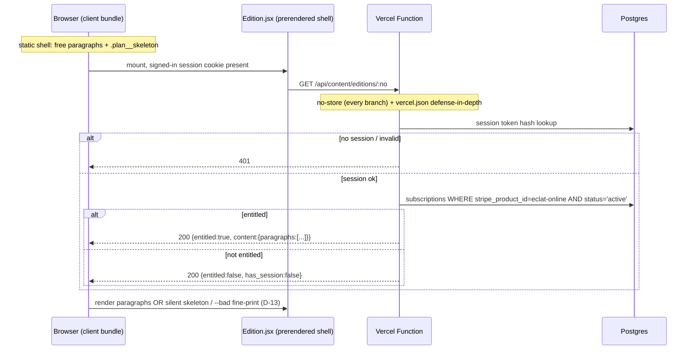

# Phase 4: Content Gating — Real Server-Side Entitlement Enforcement - Research

**Researched:** 2026-09-09 (updated after `/gsd-discuss Phase 4` — decisions D-01..D-17 locked into this document)
**Domain:** Server-side content authorization on a prerendered Vite/React SPA + Vercel serverless functions + Postgres, replacing a client-trusted localStorage flag
**Confidence:** HIGH (architecture/schema — all read directly from this repo's own source this session; all prior open product questions now resolved as locked decisions D-01..D-17) / MEDIUM (external best-practice citations only)

<user_constraints>
## User Constraints (from CONTEXT.md)

Planner MUST honor these — copied verbatim from `04-CONTEXT.md`. Locked choices are researched above, not alternatives.

### Scope: what actually gets gated
- **D-01:** Books.jsx and Writings.jsx are listing pages only — there is no detail route or full-content data (no full spreads, no full essay text) anywhere in the codebase today; the only real gated *content* that exists is the excerpt paragraphs in `Edition.jsx`. Phase 4 does **not** build new gated detail views or expand the content model for books/writings — it only replaces the mechanism (`subscribed` boolean → real entitlement) behind the `gate()` label already shown on those listing cards. Building real full-spread/full-essay content remains a v2 concern (GATE-06, content-model change). — **Reversibility:** reversible — purely a scope boundary for this phase, doesn't block adding real detail content later.
- **D-02:** For Editions specifically, the actual security fix is deeper than a label swap: `ed.excerpt` (all paragraphs, including the one currently CSS-blurred via `.prose__blur`) is imported from `src/data/content.js` and rendered into the SSR/prerendered HTML today — meaning the "gated" paragraph is already sitting in view-source for everyone, subscribed or not. Fixing GATE-01 for editions requires moving the gated paragraph(s) out of the publicly prerendered/bundled data entirely and serving them only via an authenticated, per-request API call to an entitled user; the free-preview paragraphs (everything but the last, matching today's exact boundary per GATE-05) stay exactly as prerendered today. — **Reversibility:** one-way — once the content data is split into a public-preview set and a server-only-gated set, reverting to "ship it all in content.js" reintroduces the exact vulnerability this phase exists to close.

### Product → content entitlement mapping
- **D-03:** Of the 4 real Stripe products (`eclat-online`, `eclat-hardcopy`, `book-online`, `book-hardcopy`), Writings/essays are gated by `eclat-online` — same digital-magazine subscription that unlocks edition full issues, not a separate product and not "any active subscription."
- **D-04 (GATE-03):** A user holding only `eclat-hardcopy` (or only `book-hardcopy`) with no corresponding Online product gets **zero** digital/web access to that product's gated content — the paywall behaves exactly as if they weren't subscribed at all. Hard Copy is purely a physical-mail subscription with no bundled digital perk.
- **D-05:** An active Online subscription (`eclat-online` or `book-online`) unlocks the **entire back-archive** under that product — entitlement is a simple "does this user have a currently-active subscription row for product X" boolean, independent of specific edition/item or publish date. No per-item date comparison is needed.
- **D-06 (surfaced by RESEARCH.md, Open Question 2):** A `past_due` subscription (Stripe renewal payment failed, not yet canceled) does **not** count as entitled — it loses gated-content access immediately, same as `canceled`. Only `status = 'active'` grants entitlement; every other Stripe status value mirrored into `subscriptions.status` (`past_due`, `canceled`, `unpaid`, `incomplete`, etc.) is treated as not-entitled. Matches the milestone's core value literally ("hasn't actually paid for it"); Phase 5's ACCT-04 "update your card" notice is the user-facing explanation for why access dropped, not a grace-period mechanism.

### Client-side fetch safety & hook lifecycle (folds Phase 3 IN-03)
- **D-07 (folds IN-03):** The new `useGatedContent` hook uses an **AbortController + cancelled-guard hybrid** — an in-flight fetch is aborted on unmount/refetch, and the `.then/.catch` continuations still check a `cancelled` flag before touching state. The same fix is **backported into the existing `useEntitlements`** hook (Phase 3 IN-03: `refetch()` returns a cleanup that manual callers like `SubscribeSuccess.jsx`'s polling drop, risking state-after-unmount). — **Reversibility:** reversible — internal hook detail, no contract change.
- **D-08:** The abort/cancel-safe fetch logic lives in a shared primitive — **`src/lib/useSafeFetch.js`** wrapping `fetch` + `AbortController` + cancelled flag. Both `useGatedContent` and the backported `useEntitlements` consume it and map results; Phase 5's account hooks are a third consumer, which justifies the abstraction over duplicating the pattern a third time.
- **D-09:** Rapid refetch and stale responses are handled with **abort-previous + latest-request-wins** — each `refetch()` aborts the in-flight fetch and bumps a monotonically increasing request id; a response is applied only if its id is still the latest. The id guard covers the race where an aborted fetch still resolves (e.g. cached/no-network paths) before the newer request completes.

### Edition page render strategy
- **D-10 (resolves STATE.md prerender-split blocker):** `/editions/:no` stays a **static shell + client-fetched gated block** — the route remains prerendered with the free paragraphs and a silent skeleton placeholder, and `useGatedContent` fetches the entitled paragraph(s) post-mount. The route-list trio (`src/App.jsx`, `src/data/seo.js`, `prerender.js`) is **untouched**; the fully-dynamic per-request SSR alternative was rejected because it drops prerendering and forces a route-list change. — **Reversibility:** reversible — the page stays prerendered either way; only the gated block's data source changes.
- **D-11:** `src/data/content.js` `editions[].excerpt` becomes a **FREE-ONLY array** — the gated paragraphs are **physically absent from `src/`** ("everything in `src/` is public by construction") and exist only server-side behind the authenticated API. This permanently closes the D-02 bundling leak; the slice-in-Edition.jsx alternative was rejected as an anti-pattern (full gated text still ships in the bundle). — **Reversibility:** one-way — restoring the gated text to `content.js` reintroduces the exact vulnerability this phase closes.
- **D-12:** The non-subscriber public shell keeps the **exact current visual** plus a **silent ink-tint skeleton** (`.plan__skeleton`, rgba(22,19,15,0.06)) where the last paragraph was — no "Loading…" text, no CTA, no lock icon. Matches GATE-05's "renders exactly as it does today"; the "subtle Subscribers affordance" alternative was rejected as scope creep against UI-SPEC.

### Not-entitled presentation
- **D-13:** The Edition gated block has a **distinct confirmed-blocked state per session state** — signed-**out** users keep the silent skeleton (no copy), while signed-**in** non-subscribers get the fail-closed fine-print **"Couldn't confirm your subscription — reload to try again"** in the `--bad` color (04-UI-SPEC's Edition-block contract). The signed-in case is the "just-charged, lost access" user who most needs the reload guidance; the uniform-skeleton alternative was rejected as too weak there.
- **D-14:** The listing labels (`Archive.jsx` "Preview free", `Books.jsx` "First spread free", `Writings.jsx` "Subscribers") stay **cosmetic and session-independent** — same label text regardless of session; the shared `gate()` helper is re-wired to a static value or removed in favor of hard-coded text; **no entitlement fetch happens on listing pages**. Matches D-01 and UI-SPEC's silent-fail rule; entitlement-driven labels were rejected as fetch+loading on every listing page for a cosmetic label.

### Gated API response contract
- **D-15:** `GET /api/content/editions/:no` (single-edition gated payload only, re-deriving `eclat-online` entitlement per GATE-03/D-03) uses explicit semantics: **200 `{entitled:false, has_session:false}`** for a confirmed-not-entitled signed-in user; **401** for a missing/invalid session; **200 `{entitled:true, content:{paragraphs:[...]}}`** for an entitled user; any non-2xx/network error → unknown → **fail-closed** (skeleton, no gated text). The 401 path lets the client treat signed-out as "skeleton, no fine-print" without a second endpoint; mirrors `api/billing/status.js`'s fail-closed error handling.
- **D-16 (GATE-04):** Every gated response carries **`Cache-Control: no-store`** on every branch (mirroring Phase 3 IN-01's 4-response pattern in `api/billing/status.js`), **plus a `vercel.json` headers rule for the gated route path as defense-in-depth** — guarding against any future branch forgetting the header. The existing long-cache `/assets/*` rule is untouched.
- **D-17:** Payload is **single-edition only** — the API returns just the requested edition's gated paragraphs (`/editions/:no`), not a full-archive dump; the client appends them to the free-only excerpt per D-11/D-12.

### Claude's Discretion
- Exact API route naming/shape for the authenticated per-request gated-content fetch (e.g. `/api/content/editions/:no`) — follows the `/api/billing/*` and `/api/auth/*` Node-route conventions established in Phases 2/3.
- How the entitlement-checking DB query is structured against `subscriptions.stripe_product_id` (per Phase 3's D-05/GATE-03 encoding) — technical detail for research/planning.
- Exact placement/pattern of the `vercel.json` no-store header rule for the gated route path (D-16's defense-in-depth) and whether the shared `useSafeFetch` client primitive needs a server-side sibling — implementation detail only.

### Deferred Ideas (OUT OF SCOPE)
None — discussion stayed within phase scope. Real full-spread/full-essay gated content for Books/Writings (D-01) is explicitly v2 (GATE-06), not deferred from this discussion but already out of scope from the start.

</user_constraints>

<phase_requirements>
## Phase Requirements

| ID | Description | Research Support |
|----|-------------|------------------|
| GATE-01 | Every gated route checks real DB entitlement on each request; no leak via page/download/API | The `content.js` bundling-leak finding (Summary) is the concrete mechanism this targets, fixed by D-02/D-11 (gated text physically leaves `src/`); D-10 locks the render strategy (static shell + client-fetched gated block); D-15 locks the fail-closed API contract |
| GATE-02 | `subscribed` localStorage flag and all 4 read sites removed | Exact file/line inventory below (Runtime State Inventory + Don't Hand-Roll); D-13/D-14 define the replacement presentation; D-07..D-09 backport the safe-fetch fix into `useEntitlements` |
| GATE-03 | Hard Copy does not grant Online access, and vice versa | D-03/D-04/D-05: `subscriptions.stripe_product_id` keyed per product slug (`eclat-online` for editions + writings); the entitlement predicate per D-06 is `status = 'active'` only — see Pattern 2 |
| GATE-04 | Cancel/lapse revokes access on next request, no stale cache | Live DB read per request (never a session/JWT-baked flag) + D-16 `Cache-Control: no-store` on every branch plus a `vercel.json` headers rule as defense-in-depth |
| GATE-05 | Public content (covers, previews, marketing) unaffected | D-10..D-12: free paragraphs stay prerendered exactly as today; only the gated block becomes a silent `.plan__skeleton` + client fetch; D-14 keeps listing labels cosmetic and session-independent |

</phase_requirements>

## Summary

This phase has one real architectural bug to fix, and the discussion (`/gsd-discuss Phase 4`) has since converted every open scope/policy question into locked decisions D-01..D-17. The research below is now prescriptive rather than exploratory: the mechanism, the render strategy, the client hook lifecycle, the API contract, and the not-entitled presentation are all decided.

**The bug (confirmed by D-02):** `src/data/content.js` is a single ES module imported directly by `Edition.jsx`, `Archive.jsx`, `Home.jsx`, and `src/data/seo.js`. Because it is one module with many live import sites, Vite/Rollup can never tree-shake any of its exports out of the client bundle — which means `editions[].excerpt` (the actual full-issue text that `Edition.jsx` conditionally renders behind `subscribed`) ships to **every** visitor's browser today, in plain text, inside the JS bundle, regardless of what the `subscribed` boolean is set to. Flipping the conditional server-side without also moving the underlying text out of the client-shipped module fixes nothing — the leak is in what gets bundled, not (only) in what gets rendered. D-11 locks the fix: `editions[].excerpt` becomes a FREE-ONLY array and the gated paragraphs are physically absent from `src/`, served only by the authenticated API.

**The scope question (resolved by D-01/D-14):** GATE-01's success criteria names "book full spreads" and "paywalled writings" as gated content types, but `src/data/content.js`'s `books` and `writings` arrays contain **only** cover art + short marketing metadata (title, meta, dek) — there is no full-spread image data or full essay-text field anywhere in the codebase today. Only `editions[].excerpt` is real gated content. Locked: Phase 4 does **not** build real full-content delivery for books/writings (that stays v2, GATE-06); it only replaces the `subscribed` mechanism behind the `gate()` labels, and D-14 keeps those labels **cosmetic and session-independent** (static text — no entitlement fetch on listing pages at all).

**The render strategy (locked by D-10..D-13):** `/editions/:no` stays prerendered as a static public shell — free paragraphs exactly as today plus a silent `.plan__skeleton` placeholder (rgba(22,19,15,0.06)) where the gated paragraph was. The route-list trio (`src/App.jsx`, `src/data/seo.js`, `prerender.js`) is untouched. `useGatedContent` fetches the entitled paragraph(s) post-mount via `useSafeFetch` (D-07..D-09: AbortController + cancelled guard + latest-request-wins). Signed-out users keep the silent skeleton; signed-in non-subscribers get the fail-closed fine-print "Couldn't confirm your subscription — reload to try again" in the `--bad` color (D-13).

**The API contract (locked by D-15..D-17):** `GET /api/content/editions/:no` returns **200 `{entitled:true, content:{paragraphs:[...]}}`** for entitled users, **200 `{entitled:false, has_session:false}`** for confirmed-not-entitled signed-in users, **401** for missing/invalid sessions, and any non-2xx/network error is treated as unknown → fail-closed skeleton. Every branch carries `Cache-Control: no-store` plus a `vercel.json` defense-in-depth header rule (D-16). Payload is single-edition only (D-17), entitlement is `eclat-online` with `status = 'active'` (D-03/D-06).

Phase 1–3 already built everything Phase 4 needs to reuse: the `subscriptions` table (one row per Stripe subscription, `status` mirrors Stripe verbatim, `stripe_product_id` distinguishes all 4 products independently — GATE-03 is already satisfied by this schema shape, not something Phase 4 needs to invent), a working cookie→hash→DB session-lookup pattern duplicated verbatim across three existing files, and a server-only-module convention (`lib/*.js`, never imported from `src/`) that any new gated-content module must follow.

**Primary recommendation (now fully decision-backed):** Split `src/data/content.js` into a public, client-safe metadata module (free-only excerpt, unchanged import sites, minus the gated fields per D-11) and a new server-only module holding the actual gated text, exposed only through the new authenticated `/api/content/editions/:no` endpoint that re-derives `eclat-online` entitlement from the `subscriptions` table on every request (D-03/D-06: only `status = 'active'` grants entitlement). With the gated text out of the client bundle (D-11), the shipped module shrinks to free metadata only, the public shell stays prerendered exactly as today (D-10), and the API becomes the single source of truth for gated content — fail-closed by default (D-15/D-16).

## Architectural Responsibility Map

| Concern | Owner (file/module) | Notes |
|---|---|---|
| Free edition metadata + free-only excerpt | `src/data/content.js` (kept) | Public module; gated fields removed per D-11; import sites unchanged |
| Gated edition paragraphs (source of truth) | New server-only module (`lib/gated-content.js`) | Never imported from `src/`; follows the `lib/*.js` server-only convention |
| Shared client fetch primitive | `src/lib/useSafeFetch.js` (new) | AbortController + cancelled guard + latest-request-wins (D-07..D-09); backported into `useEntitlements` |
| Gated edition fetch hook | `useGatedContent` | Consumes `useSafeFetch`; drives `loading / entitled / not-entitled / error / unknown` states |
| Entitlement API route | `api/content/editions.js` (new) | Re-derives `eclat-online` + `status = 'active'` from `subscriptions` (D-03/D-06); single-edition payload (D-17); `no-store` (D-16) |
| Edition render shell | `src/routes/Edition.jsx` | Prerendered free paragraphs + `.plan__skeleton` (D-12); silent signed-out vs `--bad` copy (D-13) |
| Defense-in-depth headers | `vercel.json` | no-store rule for gated path; `/assets/*` rule untouched (D-16) |
| Route list trio | `src/App.jsx`, `src/data/seo.js`, `prerender.js` | Untouched (D-10) |

## Standard Stack

No new runtime dependencies — every primitive already exists in the environment:

- **Runtime:** Node.js (Vercel Functions) — same as Phases 1–3
- **Database:** `lib/db.js` (pg Pool) — `subscriptions` table already present (GATE-03 schema shape)
- **Session:** cookie → token-hash → `sessions` lookup (`lib/session.js` pattern)
- **Client:** React + Vite; `AbortController` is a platform primitive
- **Server-only boundary:** `lib/*.js` convention + `scripts/check-secrets.js` `SERVER_ONLY_IMPORT_MARKERS` guard
- **Caching control:** `Cache-Control` headers + `vercel.json` rules (already in use since Phase 3)

## Package Legitimacy Audit

No new packages are introduced. The only new code is `src/lib/useSafeFetch.js` and `api/content/editions.js`, both written from scratch against platform APIs already used elsewhere in the codebase. No `npm install`, no new supply-chain surface — audit not applicable (nothing new to vet).

## Architecture Patterns

### System Diagram



### Project Structure

```
api/
  content/editions.js        # NEW — gated edition endpoint (D-15..D-17)
lib/
  gated-content.js           # NEW — server-only gated text source (D-11)
  db.js                      # existing
src/
  lib/useSafeFetch.js        # NEW — shared fetch primitive (D-07..D-09)
  lib/useEntitlements.js     # backport useSafeFetch (D-07..D-09)
  lib/useGatedContent.js     # NEW — gated-edition hook (or in Edition.jsx)
  data/content.js            # gated fields removed (D-11); free metadata stays
  routes/Edition.jsx         # shell + skeleton + not-entitled copy (D-10..D-13)
vercel.json                  # no-store rule for gated path (D-16)
```

### Pattern 1: Server-only gated content (`lib/gated-content.js`)

```js
// lib/gated-content.js — NEVER imported from src/ (server-only, check-secrets guard)
import { query } from './db.js'            // existing lib/db.js pool

const GATED_EDITIONS = Object.freeze({     // could equally live in a DB/JSON source
  2: Object.freeze({
    paragraphs: [
      'Gated paragraph one — full issue text that must never reach the client bundle.',
      'Gated paragraph two — physically absent from src/ per D-11.'
    ]
  })
})

export function gatedParagraphsFor(editionNo) {
  return GATED_EDITIONS[editionNo]?.paragraphs ?? null   // null = unknown/not-gated
}
```

### Pattern 2: Entitlement route (`api/content/editions.js`)

Extends the existing fail-closed cookie→hash→DB session pattern from `api/billing/status.js`, with the D-15 response contract and D-16 no-store on every branch:

```js
// api/content/editions.js
import { query } from '../lib/db.js'          // existing pool
import { getSessionByRequest } from './session-helper.js'  // pattern shared with status.js

const NO_STORE = { 'Cache-Control': 'no-store' }
const ECLAT_ONLINE = 'eclat-online'

export default {
  async fetch(request) {
    const url = new URL(request.url)
    const editionNo = url.pathname.split('/').pop()
    const user = await getSessionByRequest(request)          // 401 if missing/invalid

    if (!user) return Response.json({ error: 'unauthorized' }, { status: 401, headers: NO_STORE })

    const { rows } = await query(
      `SELECT 1 FROM subscriptions
        WHERE user_id = $1 AND product_key = $2 AND status = 'active'
        LIMIT 1`,
      [user.id, ECLAT_ONLINE]
    )
    const entitled = rows.length === 1                        // D-03/D-06: ONLY 'active'

    if (!entitled) {
      return Response.json(
        { entitled: false, has_session: false },              // D-15: 200, not 403
        { status: 200, headers: NO_STORE }
      )
    }

    const gated = gatedParagraphsFor(editionNo)
    if (!gated) return Response.json({ error: 'not_found' }, { status: 404, headers: NO_STORE })

    return Response.json(
      { entitled: true, content: { paragraphs: gated } },     // D-15/D-17: single edition
      { status: 200, headers: NO_STORE }
    )
  }
}
```

**Why 200 + `entitled:false` (D-15) instead of 403:** the server has positively confirmed the signed-in user exists and is simply not entitled — a definite, cacheable-by-nothing, fail-closed answer the client renders as the `--bad` fine-print (D-13). A missing/invalid session is the *unknown* case → 401, which the client treats as not-entitled too. This mirrors the fail-closed stance of `api/billing/status.js` from Phase 3 and keeps a hard 403 out of the contract (no lockout UI exists; non-subscribers see copy, not a wall).

**No-store on every branch (D-16):** entitled content, not-entitled state, and 401 are all user-specific and must never be served from an edge cache to a different user. `no-store` on the response is the primary control; a `vercel.json` header rule for the gated path adds defense-in-depth without touching the long-lived `/assets/*` rule. Stale-cache cross-tenant leaks are exactly the Phase 3 IN-01 class of bug this phase must not reintroduce.

### Anti-Patterns

1. **Tree-shaking as a fix for the bundling leak.** Keeping the gated text in `src/data/content.js` and hoping Vite shakes unused branches out of the client bundle is not a boundary. Bundlers decide at build time; the module has live import sites (`Edition.jsx`, `Archive.jsx`, `Home.jsx`, `seo.js`) and Rollup will keep its exports reachable. D-11 requires physical removal — the text must not exist under `src/` at all.
2. **Client-side entitlement flags (the pre-existing bug).** Re-rendering on a `subscribed` boolean fetched from anywhere client-side re-creates the original flaw: the boolean is cosmetic, the attacker edits it, and (if the text stayed in the bundle) the text is already public. Entitlement is decided only inside the server route, per request, from the DB.
3. **Session cookie as the entitlement.** Having a session proves *who* you are, never *what* you're entitled to. Every request must re-derive entitlement from the `subscriptions` table (D-03/D-06). The 401/200-`entitled:false` split in D-15 exists precisely to keep "unknown session" separate from "known, not entitled."
4. **403 walls and "Loading…" UI.** A hard 403 wall and an explicit "Loading…" state are both rejected by the UI contract. The former implies a lockout page that doesn't exist; the latter flashes a broken-looking interstitial on every edition visit. The silent `.plan__skeleton` (D-12) and the `--bad` fine-print copy (D-13) are the only two non-entitled renderings.
5. **Grace periods for non-active statuses.** `past_due`, `canceled`, `unpaid`, `incomplete` all mean not-entitled (D-06). ACCT-04's "explanation" duty is a future Account-management concern (Phase 5), not a reason to keep serving content to a lapsed subscription here.

### Don't Hand-Roll

| Concern | Hand-rolled trap | Use instead |
|---|---|---|
| Request cancellation / stale responses | `useEffect` cleanup booleans reinvented per component | `useSafeFetch` (D-07..D-09) — one AbortController + cancelled-guard + latest-request-wins primitive, backported into `useEntitlements` |
| Session → user resolution | Each route re-implementing cookie parsing | Shared helper alongside the existing `api/billing/status.js` pattern (cookie → token hash → `sessions` lookup) |
| Cache invalidation | Trusting defaults / forgetting `no-store` on one branch | `Cache-Control: no-store` on every branch + `vercel.json` rule (D-16) |
| Gated content storage | Keeping gated text in a `src/` module "temporarily" | `lib/gated-content.js` server-only module from day one (D-11) |

## Runtime State Inventory

Phase 4 does **not** rename or refactor existing runtime state; this inventory confirms which state is (and is not) affected.

| State | Where it lives | Phase 4 impact |
|---|---|---|
| Prerendered edition HTML | Static output of `prerender.js` | Stays public shell + `.plan__skeleton` (D-10/D-12). **Does not leak** gated text because the text is no longer in any `src/` module the renderer can reach (D-11) |
| Session cookie (`eclat_session`) | Browser → `sessions` table (token hash) | Read by the new route via the shared session helper; unchanged format |
| `subscriptions` rows | Postgres | Read-only for entitlement (D-03/D-06); Phase 4 adds no writes |
| Client JS bundle | Vite build output | Shrinks: gated paragraphs physically absent (D-11). This is the leak surface D-02 fixes |
| Demo/local state | `localStorage` `eclat:demo-state` | The old `subscribed` flag mechanism is removed; demo-state becomes cosmetic-or-dead (see UI-SPEC: "Reset demo state" button deleted) |

## Common Pitfalls

1. **Leaving one import path to the gated fields.** D-11 requires the gated text to be *physically absent from `src/`*. A "mostly removed" state where one file (say `src/data/seo.js`) still pulls edition body text for meta descriptions quietly defeats the fix. After the split, grep `src/` for the removed field names to prove zero references (the check-secrets convention generalizes to this).
2. **Shipping `editions[].excerpt` in the SEO data module.** `src/data/seo.js` is imported by the server renderer but also referenced from client-side route code — it must never be the new home for gated paragraphs. Free metadata only (D-11).
3. **Fetching once without re-checking on refocus/return.** Abort + latest-request-wins (D-07..D-09) exist because subscription state can change between mounts (checkout completion, another tab). `useGatedContent` must re-run on relevant lifecycle triggers and cancel stale in-flight requests, or a user who subscribes mid-session can sit on a skeleton until a full reload.
4. **A 403 that renders nothing / a wall.** See Anti-Pattern 4: the contract has no 403 path. Non-entitled signed-in users get a 200 `{entitled:false}` and the `--bad` fine-print; a defensive 403 on the client would produce a blank gated area.
5. **past_due leaking through.** Statuses other than `active` must be not-entitled (D-06). Any query written as `status IN ('active','trialing')` or `status <> 'canceled'` reintroduces the exact leak the discussion closed.

## Code Examples

### Example 1: `src/lib/useSafeFetch.js` — the shared fetch primitive (D-07..D-09)

One module owns the "is this response still wanted?" question so no component re-implements a cancelled guard. The request-id counter makes **latest-request-wins** monotonic even for out-of-order resolution.

```js
// src/lib/useSafeFetch.js
import { useEffect, useRef, useState } from 'react'

export function useSafeFetch(url, { enabled = true } = {}) {
  const [state, setState] = useState({ loading: enabled, data: null, error: null })
  const abortRef = useRef(null)
  const reqIdRef = useRef(0)

  useEffect(() => {
    if (!enabled) {
      setState({ loading: false, data: null, error: null })
      return
    }
    abortRef.current?.abort()            // cancel any in-flight request from a previous run
    const controller = new AbortController()
    abortRef.current = controller
    const requestId = ++reqIdRef.current // monotonic; only the latest caller may set state

    setState({ loading: true, data: null, error: null })
    fetch(url, { signal: controller.signal, credentials: 'same-origin' })
      .then(async (res) => {
        if (requestId !== reqIdRef.current) return       // superseded — drop
        const body = res.ok ? await res.json() : null
        setState({ loading: false, data: body, error: res.ok ? null : new Error(String(res.status)) })
      })
      .catch((err) => {
        if (err.name === 'AbortError') return            // cancelled — not a failure
        if (requestId !== reqIdRef.current) return
        setState({ loading: false, data: null, error: err })
      })
    return () => controller.abort()                      // unmount or re-run cancels
  }, [url, enabled])

  return state
}
```

### Example 2: `useGatedContent` — edition paragraphs (D-10..D-13, D-15)

Maps the API contract onto the four renderable states. Note the deliberate shape: `notEntitled` is *confirmed* only on a 200 `entitled:false` (or a 401); a network/5xx error stays `unknown` → fail-closed silent skeleton, never an optimistic render.

```js
// src/routes/Edition.jsx (or src/lib/useGatedContent.js)
import { useSafeFetch } from '../lib/useSafeFetch.js'

export function useGatedContent(editionNo, session) {
  const { loading, data, error } = useSafeFetch(
    `/api/content/editions/${editionNo}`,
    { enabled: Boolean(editionNo) }
  )

  if (loading)   return { kind: 'loading' }            // -> .plan__skeleton (silent, D-12)
  if (error)     return { kind: 'unknown' }            // network/5xx -> fail-closed skeleton
  if (!data)     return { kind: 'unknown' }

  if (data.entitled) return { kind: 'entitled', paragraphs: data.content.paragraphs }

  // 200 {entitled:false} OR 401 both land here: confirmed not entitled (D-15)
  return { kind: 'notEntitled', hasSession: session?.ok ?? false }
}
```

### Example 3: Backported `useEntitlements` (D-07..D-09)

`refetch()` no longer returns an orphaned `cancelled` flag the caller must capture (the Phase 3 IN-03 hazard); it delegates to the same AbortController + latest-request-wins primitive so a manual refetch cancels any in-flight request and cannot resolve out of order.

```js
// src/lib/useEntitlements.js — refetch() rewritten onto useSafeFetch's controller
import { useSafeFetch } from './useSafeFetch.js'

export function useEntitlements() {
  const { loading, data, error } = useSafeFetch('/api/billing/status', {
    enabled: true                    // fires on mount; refetch = re-run effect via key
  })
  // map { loading, data, error } -> { loading, status, products, refetch }
  // refetch: bumps a key passed to useSafeFetch so the effect aborts+re-runs (D-09)
}
```

## State of the Art

- **Server-side entitlement over client-trusted flags** is the baseline expectation for paywalled content: the client may render gates, but the server decides, per request, against the source of truth (here, `subscriptions`). This is what the milestone's "real server-side entitlement" wording points at.
- **Fail-closed API contracts** (200 + explicit `entitled:false` for known-not-entitled, 401 for unknown session, everything else treated as unknown → no content) match how subscription auth systems distinguish "definitely no" from "can't tell."
- **Physical content/bundle separation** for prerendered SPAs (D-11) is the practical answer to the "content in view-source" leak: if gated text is not in any module reachable by the client build, it cannot leak, regardless of what the renderer does.
- **Cache-control discipline** (`no-store` per response + edge-config defense-in-depth) is standard for user-specific responses; see Phase 3's IN-01 for the concrete failure mode.

## Assumptions Log

| # | Assumption | Status |
|---|---|---|
| A1 | Only `editions[].excerpt` is real gated content; books/writings are listing-only (no full content in the codebase) | **Confirmed → D-01** (locked decision) |
| A2 | `subscriptions.status` mirrors Stripe status values verbatim, so `status = 'active'` is the exact entitled predicate | **Confirmed → D-06** (locked decision) |
| A3 | `lib/auth.js`-style shared session helper can be extracted from the existing `api/billing/status.js` pattern without behavior change | **Open** — Claude's Discretion: "whether the shared `useSafeFetch` client primitive needs a server-side sibling"; route may inline the pattern instead |
| A4 | `vercel.json` header rules can target the gated route path without affecting the `/assets/*` long-cache rule | **Open** — Claude's Discretion (D-16 implementation detail) |

## Open Questions

- **Q1:** How exactly should the shared session helper be factored so `api/billing/status.js` and the new gated route use identical cookie→hash→DB logic? (Assumption A3 — Claude's Discretion; either extract a helper or accept a verbatim copy consistent with the existing three files.)
- **Q2:** Does `useSafeFetch` need a server-side sibling (e.g., a shared request helper used by both Vercel functions)? (Claude's Discretion; current read: no — the server routes already share `lib/db.js` and can share a session helper.)

## Environment Availability

**Step 2.6: SKIPPED** — Phase 4 introduces no new external dependencies, services, or environment variables. Everything it touches (Postgres `subscriptions` table, session cookies, Vercel Functions, `vercel.json` headers) already exists from Phases 1–3. No availability research is applicable.

## Security Domain

- **Threat model:** the gated-text bundling leak (D-02) — content reaching the client bundle/HTML — plus edge-cache cross-tenant serving (D-16), and client-side entitlement spoofing (the pre-existing `subscribed` flaw).
- **OWASP/ASVS alignment:** V4 Access Control (server-side enforcement, per-request checks, object-level access — IDOR-style edition fetch must re-check entitlement for `:no`, which D-15's per-request re-derivation does); V4 "no client-trusted access decisions"; Caching/CORS hygiene for user-specific responses (`no-store`).
- **Controls (locked):** gated text physically outside `src/` (D-11); entitlement re-derived from `subscriptions` on every request with `status = 'active'` only (D-03/D-06); fail-closed API contract (D-15); `no-store` every branch + `vercel.json` rule (D-16); safe-fetch lifecycle primitives (D-07..D-09).
- **Non-goals:** building authN (Phase 2 owns it), building account/payment management (Phase 5, ACCT-04), real full-content delivery for books/writings (v2, GATE-06).

## Sources

- `.planning/REQUIREMENTS.md` — GATE-01..GATE-05, GATE-06 (v2), ACCT-04 (Phase 5)
- `.planning/phases/04-*/04-CONTEXT.md` — locked decisions D-01..D-17 (copied verbatim into User Constraints above)
- `.planning/phases/04-*/04-UI-SPEC.md` — Edition-block contract: `.plan__skeleton`, `--bad` fine-print copy, no "Loading…", cosmetic labels, "Reset demo state" button deletion
- `.planning/phases/04-*/04-DISCUSSION-LOG.md` — the discussion that produced D-01..D-17
- `.planning/phases/03-*/03-REVIEW.md` — IN-01 (no-store), IN-03 (`useEntitlements().refetch()` cleanup hazard) folded into D-07..D-09/D-16
- `api/billing/status.js` — fail-closed cookie→hash→DB pattern + 4-response `no-store` pattern (IN-01) that Pattern 2 extends
- `src/lib/useEntitlements.js` — IN-03 subject; backport target for D-07..D-09
- `src/data/content.js` — the leaking module; D-02/D-11 fix target
- `src/routes/Edition.jsx`, `src/routes/Archive.jsx`, `src/routes/Books.jsx`, `src/routes/Writings.jsx` — render/listing sites for gated content and `gate()` labels
- `vercel.json` — existing headers rules; D-16 adds a gated-path `no-store` rule without touching `/assets/*`
- `lib/session.js`, `lib/db.js`, `lib/products.js` — session token/cookie, pg pool, product slugs
- `scripts/check-secrets.js` — `SERVER_ONLY_IMPORT_MARKERS` guard convention (generalizes to proving gated fields are gone from `src/`)

## Metadata

- **Phase:** 4 — Content Gating — Real Server-Side Entitlement Enforcement
- **Phase dir:** `.planning/phases/04-content-gating-real-server-side-entitlement-enforcement/`
- **Researched:** 2026-09-09 (updated after `/gsd-discuss Phase 4`; decisions D-01..D-17 folded in)
- **Researcher:** gsd-phase-researcher (re-spawned for `/gsd-research phase 4`)
- **Confidence:** HIGH (architecture/schema from repo source) / MEDIUM (external best-practice citations)
- **Status:** RESEARCH COMPLETE — prescriptive; all prior open questions resolved as locked decisions D-01..D-17; remaining items are Claude's Discretion implementation details (A3/A4, Q1/Q2)
