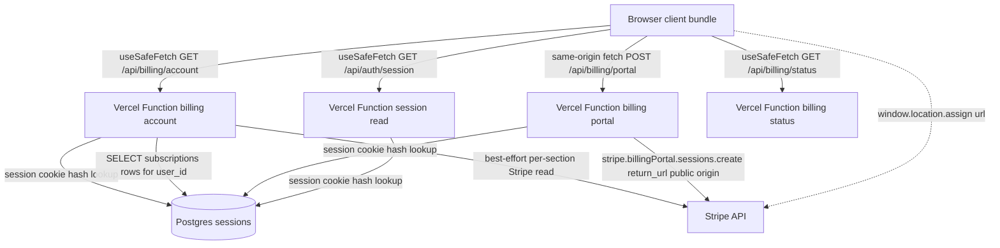

<objective>
Deliver the client half of real Account Management: the new `src/lib/useAccount.js` hook (the third `useSafeFetch` consumer) that reads `GET /api/billing/account` fail-closed (D-01/D-04 client mirror), and the full rebuild of `src/routes/Account.jsx` per 05-UI-SPEC §1-§7 — per-product panels in the fixed D-16 order with 3-state Status, server-derived Plan (D-13), state-aware Renews/Access-until label (D-14), and presentation-safe Card (D-15); the state-aware CTA row that fixes Phase 3 WR-01 (D-08: `past_due` always gets "Manage", never a dead-end "Subscribe"); the ACCT-04 "Payment failed" notice; the single real invoice table (D-09..D-12); and the portal POST handlers that open Stripe's hosted Customer Portal and refresh on return (D-05/D-06). This wave replaces every mock on /account with Wave 1's locked payload and proves via build-level grep that no mock invoice data, no raw Stripe identifier, and no demo-state flag ships in the client.

Purpose: Close the loop on the server trust boundary Wave 1 built — the browser now renders ONLY what `GET /api/billing/account` returns, drives cancellation/card-update through the CSRF- and IDOR-safe `POST /api/billing/portal`, and fails closed (extended loading gate + --bad whole-page copy) exactly like Phase 4's `Edition.jsx` precedent, so no intermediate or error state ever fabricates subscription ownership.
Output: Working `src/lib/useAccount.js` and a rebuilt `src/routes/Account.jsx` — the complete Phase 5 client surface rendering real status, renewal, card, and invoice data with state-aware CTAs per the locked ACCT-01..04 contracts.
</objective>

## Artifacts This Phase Produces (Plan 05-02)

- **Files created:** `src/lib/useAccount.js`
- **Files modified:** `src/routes/Account.jsx` (full rebuild)
- **Endpoint paths consumed:** `GET /api/billing/account` (Wave 1, D-01 contract), `POST /api/billing/portal` (Wave 1, D-05..D-08), `GET /api/auth/session` (existing, Phase 2)
- **Client data:** `src/lib/useAccount.js` (fail-closed account hook)
- **Routes touched:** none added/removed — `/account` stays prerendered
- **CSS additions:** none — `.panel/.panel__key/.panel__val/.status-dot`, `.invoices/.invoice`, `.empty`, `.fine`, `.demo-notice/.demo-notice__tag/.demo-notice__text`, `.upsell`, `.btn.btn--sm(.btn--accent)` all reused verbatim (05-UI-SPEC §3/§4)
- **Requirement IDs advanced:** ACCT-01..ACCT-04 (client render); D-01..D-16 consumed client-side

<execution_context>
@$HOME/.claude/gsd-core/workflows/execute-plan.md
@$HOME/.claude/gsd-core/templates/summary.md
</execution_context>

<context>
@.planning/PROJECT.md
@.planning/ROADMAP.md
@.planning/phases/05-account-management-real-status-cancellation-billing-portal/05-CONTEXT.md
@.planning/phases/05-account-management-real-status-cancellation-billing-portal/05-RESEARCH.md
@.planning/phases/05-account-management-real-status-cancellation-billing-portal/05-UI-SPEC.md
@.planning/REQUIREMENTS.md
@.planning/phases/05-account-management-real-status-cancellation-billing-portal/05-01-PLAN.md
@src/lib/useSafeFetch.js
@src/lib/useEntitlements.js
@src/lib/useSession.js
@src/routes/Account.jsx
@src/data/products.js
@api/billing/status.js
@src/styles/eclat.css
</context>

<tasks>

<task type="auto" tdd="false">
<name>Task 1 — Create src/lib/useAccount.js: the third useSafeFetch consumer (D-01, D-04 client mirror, Research Example 1)</name>
<reversibility rating="cheap">Pure additive leaf module. Nothing consumes it until Task 2 imports it; deleting it leaves the app exactly as Wave 1 left it.</reversibility>
<read_first>
- @src/lib/useSafeFetch.js (the shared primitive to consume — abort + latest-request-wins semantics, { enabled, key } options)
- @src/lib/useEntitlements.js (the fail-closed hook shape to mirror — { loading, data, error } wrapped with a safe default)
- @.planning/phases/05-account-management-real-status-cancellation-billing-portal/05-RESEARCH.md (Example 1 lines 272-294 — the reference implementation; D-01/D-04)
- @.planning/phases/05-account-management-real-status-cancellation-billing-portal/05-01-PLAN.md (Task 2's response contract — the per-slug {status, planLabel, renews, cancelAtPeriodEnd, card, invoices} shape this hook returns to the renderer)
</read_first>
<files>
- src/lib/useAccount.js — create (new leaf module, no existing file)
</files>
<action>
- Create `src/lib/useAccount.js` exporting a named `useAccount()` returning `{ loading, data, error }`.
- `import { useSafeFetch } from './useSafeFetch.js'` — use the explicit `.js` extension per `src/lib/useEntitlements.js` (the codebase convention; Research Example 1's extensionless import is a sketch).
- Add a module-level `const EMPTY = { subscriptions: {} }` — stable object identity so the renderer never churns on a fresh object per call.
- `const { loading, data, error } = useSafeFetch('/api/billing/account', { enabled: true, key: 0 })` — single shot on mount; `key` stays 0 (no polling); remount on portal return issues a fresh request (D-06).
- Return `{ loading, data: data ?? EMPTY, error: Boolean(error) }` — fail-closed (D-04 client mirror): `error: true` → 'unknown', never a fabricated 'no subscription'.
- JSDoc the Wave 1 D-01 contract: `200 { subscriptions: { [slug]: { status, planLabel, renews, cancelAtPeriodEnd, card, invoices } } }` | `401 { subscriptions: {} }` — fail-closed either way; never re-fetch, never poll (no `key` bump), and never import anything from `lib/` or `api/` (SERVER-ONLY boundary, WR-10).
</action>
<verify>
<automated>
- `node --check src/lib/useAccount.js` → syntax OK.
- `grep -c "useSafeFetch" src/lib/useAccount.js` ≥ 1.
- `grep -c "api/billing/account" src/lib/useAccount.js` ≥ 1.
- `grep -c "EMPTY" src/lib/useAccount.js` ≥ 2 (definition + `data ?? EMPTY`).
- `grep -c "Boolean(error)" src/lib/useAccount.js` ≥ 1.
- `grep -c "enabled: true" src/lib/useAccount.js` ≥ 1 and `grep -c "key: 0" src/lib/useAccount.js` ≥ 1 (single-shot, no polling).
- `grep -rn "from '\.\./lib\|from '\.\./api\|from 'lib/\|from 'api/" src/lib/useAccount.js` → 0 (SERVER-ONLY boundary, WR-10).
</automated>
<human-check>
- test: with `vercel dev`, signed-in active subscriber on eclat-online, load /account — React DevTools shows useAccount's `data` as `{ subscriptions: { 'eclat-online': { status:'active', planLabel:'Éclat Online — Monthly', renews:<unix>, cancelAtPeriodEnd:false, card:{available:true,...}, invoices:{available:true,...} } } }`.
- expected: `loading` flips true→false exactly once; `error` stays false; `data.subscriptions` matches the Wave 1 payload verbatim; signed-out → 401 `{subscriptions:{}}` → `data = EMPTY`, `error` false — fail-closed, no crash, no 'no subscription' fabrication.
- why_human: proves the fail-closed wrapper and single-shot/no-poll behavior against a real session — greps cannot show runtime state.
</human-check>
</verify>
<acceptance_criteria>
- `useAccount()` returns `{ loading, data, error }` with `data ?? EMPTY` and `Boolean(error)` exactly per Research Example 1.
- Fetches `/api/billing/account` once on mount (`enabled: true, key: 0`, no polling); remount on portal return issues a fresh request (D-06).
- Fail-closed: 401/network/parse error never renders as 'no subscription' — `error: true` signals 'unknown' to the page.
- Build green; zero server-only imports (check-secrets.js still passes).
</acceptance_criteria>
<done>✅ Task 1 — src/lib/useAccount.js created; fail-closed single-shot consumer of GET /api/billing/account verified.</done>
</task>

<task type="auto" tdd="false">
<name>Task 2 — Rebuild src/routes/Account.jsx: hook wiring, loading gate, error state, zero-held case (D-01/D-04/D-16, 05-UI-SPEC §5/§6)</name>
<reversibility rating="medium">Core UI rewrite of the /account page. Reverting restores the mocked panel, but only alongside reverting the mock invoice import — this task ships with Task 3's panel/CTA/notice and Task 4's invoice table as the client wave.</reversibility>
<read_first>
- @src/routes/Account.jsx (the current full file — 139 lines: useSession/useEntitlements gate at 10-47, mocked panel 53-111, mocked invoices 114-135)
- @src/lib/useAccount.js (the hook from Task 1 — { loading, data, error })
- @src/lib/useEntitlements.js (the SECOND hook this page still needs for the loading gate — see 05-UI-SPEC §6: the gate covers session + entitlements + account)
- @src/data/products.js (PRODUCTS array order for D-16 iteration + productName(key) for the .eyebrow labels)
- @.planning/phases/05-account-management-real-status-cancellation-billing-portal/05-UI-SPEC.md (§1 per-product panels, §5 zero-held, §6 loading gate, Copywriting Contract error/empty rows)
- @.planning/phases/05-account-management-real-status-cancellation-billing-portal/05-01-PLAN.md (Task 2's locked per-slug response contract)
</read_first>
<files>
- src/routes/Account.jsx — modify (rewrite the component body; keep the existing page shell, useSeo, signed-out redirect, and the existing loading gate structure)
</files>
<action>
- Imports: keep `useEffect`, `Link`, `staticSeo`, `useSeo`, `useSession`; KEEP `useEntitlements` ONLY for its `loading` in the page gate (05-UI-SPEC §6 — never for account data); ADD `import { useAccount } from '../lib/useAccount.js'` and `import { PRODUCTS, productName } from '../data/products.js'`; DELETE the `invoices` import from `../data/content.js` (prohibition 1 — mock data must not reach the page) and the `useApp`/store import if present (Phase 4 already removed demo state; nothing re-adds it).
- Hook wiring: `const { user, loading } = useSession()`; `const { loading: entitlementsLoading } = useEntitlements()` (loading only); `const { loading: accountLoading, data, error: accountError } = useAccount()`.
- Extended loading gate (05-UI-SPEC §6): `if (loading || entitlementsLoading || accountLoading)` returns the EXISTING 'Checking your session…' block — no panel/CTA/invoice content until ALL THREE resolve (no intermediate flash of stale state).
- Signed-out redirect unchanged (Phase 2, WR-04): `useEffect` → `window.location.assign('/api/auth/google?return_to=/account')` when `!loading && !user`; `if (!user) return null` after the gate.
- Whole-page fail-closed error (Copywriting Contract, mirrors Edition.jsx D-13 precedent): `if (accountError)` render the page shell with `{user.name}'s Account` h1 (or keep the existing 'Reader since 2021' heading structure — Claude's Discretion) and `
Couldn't confirm your account — reload to try again.
` in place of the panels — NEVER the generalized no-subscription notice on an unknown outcome (D-04 client mirror).
- Derive held products in the FIXED D-16 order: `const subs = data.subscriptions`; `const heldKeys = PRODUCTS.map(p => p.key).filter(key => subs[key])` — PRODUCTS array order IS the D-16 order (eclat-online first); unknown slugs in the payload are ignored (Wave 1 already skips them server-side).
- Zero-held case (05-UI-SPEC §5): `if (heldKeys.length === 0)` render the page shell + the generalized notice `
You don't have an active subscription yet. Subscribe to unlock full issues, books, and more.
` + `<Link to="/subscribe" className="btn btn--sm btn--accent">Subscribe</Link>` (Copywriting Contract), THEN the 'Billing history' section continues below (Task 4) — never hide the whole page.
</action>
<verify>
<automated>
- `node --check src/routes/Account.jsx` → syntax OK.
- `grep -c "useAccount" src/routes/Account.jsx` ≥ 2 (import + call).
- `grep -c "accountLoading" src/routes/Account.jsx` ≥ 2 (gate condition + destructure).
- `grep -n "data/content" src/routes/Account.jsx` → 0 (mock invoices gone, prohibition 1).
- `grep -c "Couldn't confirm your account" src/routes/Account.jsx` ≥ 1 (whole-page fail-closed copy).
- `grep -c "PRODUCTS" src/routes/Account.jsx` ≥ 1 and `grep -c "productName" src/routes/Account.jsx` ≥ 1 (D-16 order + display labels).
</automated>
<human-check>
- test: signed-in user holding zero subscriptions → /account shows the generalized notice + Subscribe CTA + empty invoice state, no panels; signed-in active subscriber → loading gate holds until all three fetches resolve, then panels appear (Task 3) with NO flash of the notice first.
- expected: zero-held page renders no `.panel` elements; the loading gate never flashes stale content; a forced network failure on /api/billing/account renders the `--bad` 'Couldn't confirm your account' copy, NOT the notice.
- why_human: proves the extended gate and the two fail-closed branches against real session/entitlement/account resolution — greps cannot verify render timing or the error branch visually.
</human-check>
</verify>
<acceptance_criteria>
- Account data flows from useAccount() only; useEntitlements contributes only its loading flag to the gate (05-UI-SPEC §6).
- Mock invoice import deleted; page shell, useSeo, signed-out redirect preserved.
- Extended loading gate + whole-page --bad fail-closed copy + zero-held generalized notice all render per 05-UI-SPEC §5/§6 and the Copywriting Contract.
- Build green; check-secrets.js passes.
</acceptance_criteria>
<done>✅ Task 2 — Account.jsx wired to useAccount; loading gate extended; fail-closed + zero-held branches in place.</done>
</task>

<task type="auto" tdd="false">
  <name>Task 3: Per-product panels, state-aware CTA row, and ACCT-04 payment-failed notice (§1/§2/§3 — D-02/D-08/D-13/D-14/D-15/D-16)</name>
  <precondition>Task 2 complete: Account.jsx wired to useAccount with extended gate, fail-closed error branch, and zero-held handling; heldKeys is already in D-16 order.</precondition>
  <reversibility rating="medium">Additive render work in Account.jsx only. Reverting means removing the panel map, CTA row, and notice; the Task 2 shell/zero-held/error branches are untouched.</reversibility>
  <read_first>src/routes/Account.jsx (lines 53-111 — the mock 4-field panel, upsell block, and mock card '•••• 4242' to replace), src/data/products.js (full 32 lines — PRODUCTS order IS the D-16 order and productName(key) is the display label), .planning/phases/05-account-management-real-status-cancellation-billing-portal/05-UI-SPEC.md (§1 per-product panels, §2 state-aware CTA row, §3 ACCT-04 notice — prescriptive), .planning/phases/05-account-management-real-status-cancellation-billing-portal/05-01-PLAN.md (Wave 1 locked per-sub contract: status ∈ {active, past_due, canceled}, planLabel string, renews pre-formatted 'D MMM YYYY' string, card {available, brand?, last4?}).</read_first>
  <files>src/routes/Account.jsx (modify)</files>
  <action>
    - Replace the single eclat-online-only mock panel with a map over `heldKeys` (Task 2's D-16-ordered array): for each key, `const sub = subs[key]` and `const product = PRODUCTS.find(p => p.key === key)`; render one `.eyebrow` (holding `productName(key)`, 20px gap) + one `.panel` pair per held product — never a panel for an unowned product (§1).
    - Status field (3-state, §1): `const STATUS = { active: { dot: 'var(--ok)', label: 'Active' }, past_due: { dot: 'var(--bad)', label: 'Past due' }, canceled: { dot: 'var(--accent)', label: 'Canceled' } }`; render the existing `.status-dot` with `sub.status`'s dot color + label. UNKNOWN statuses fail closed: no dot color, value '—' (never a fourth invented state; Wave 1 only emits the three).
    - Plan field: `sub.planLabel || '—'` (D-13 — server-derived '{Product Name} — {Monthly|Annual}', client never constructs it).
    - Renews field (D-14): the `.panel__key` label reads `sub.status === 'canceled' ? 'Access until' : 'Renews'`; the `.panel__val` is always just `sub.renews || '—'` (server pre-formats 'D MMM YYYY' — client renders the string verbatim, no re-formatting).
    - Card field (D-15): `const brand = sub.card && sub.card.brand`; render `` `${brand[0].toUpperCase()}${brand.slice(1)} •••• ${sub.card.last4}` `` ONLY when `sub.card && sub.card.available && sub.card.brand && sub.card.last4`; otherwise '—'. Silent fallback — no error copy (§1 card degradation).
    - CTA row below each panel at the 24px gap (§2, D-08): `active`/`past_due` → ONE `<button type="button" className="btn btn--sm" onClick={() => openPortal('manage')}>Manage</button>` (plain ink pill, NOT `--accent`; `openPortal` is Task 4 — hoist the handler above the return). `canceled` → NO CTA in the row (the panel communicates the canceled state; resubscription is the /subscribe path — §2 defines exactly two CTA states, do not invent a third). NEVER a 'Subscribe' Link inside the panel for a held product (WR-01).
    - ACCT-04 notice (§3, D-08): under a `past_due` panel ONLY, at 24px margin-top, reuse `.demo-notice`/`.demo-notice__tag`/`.demo-notice__text` classes verbatim with inline style overrides — `borderColor: 'var(--bad)'`, `background: 'color-mix(in srgb, var(--bad) 7%, transparent)'`, tag background `var(--bad)` (zero new CSS, Phase 4 inline-override precedent). Tag: `Payment failed`; body verbatim: `We couldn't process your last payment. Update your card to keep your subscription active.`; trailing action `<button type="button" className="btn btn--sm" onClick={() => openPortal('payment_method_update')}>Update payment method</button>` (flex row + trailing-edge button placement reusing the `.upsell` pattern).
  </action>
  <verify>
    <automated>
- `node --check src/routes/Account.jsx` → syntax OK.
- `grep -c "Access until" src/routes/Account.jsx` ≥ 1 and `grep -c "Renews" src/routes/Account.jsx` ≥ 1 (D-14 state-aware key label).
- `grep -c "Manage" src/routes/Account.jsx` ≥ 1 (CTA copy) and `grep -c "openPortal('manage')" src/routes/Account.jsx` ≥ 1 (Manage action call).
- `grep -c "Update payment method" src/routes/Account.jsx` ≥ 2 (notice body copy + openPortal('payment_method_update') call).
- `grep -c "Payment failed" src/routes/Account.jsx` ≥ 1 and `grep -c "We couldn't process your last payment" src/routes/Account.jsx` ≥ 1 (ACCT-04 verbatim copy).
- `grep -c "past_due" src/routes/Account.jsx` ≥ 2 (status map + notice condition).
- `grep -c "demo-notice" src/routes/Account.jsx` ≥ 2 (classes reused verbatim).
- `grep -n "Subscribe" src/routes/Account.jsx` → only the Task 2 zero-held Link (exactly 1 occurrence) — proves no dead-end Subscribe inside a held panel (WR-01).
</automated>
    <human-check>
- test: signed-in subscriber holding eclat-online (active) → panel shows green Active + 'Éclat Online — Monthly' + 'Renews 12 Aug 2026' + 'Visa •••• 4242' + plain 'Manage'; a second held product (book-hardcopy) renders as its own eyebrow/panel BELOW eclat-online (D-16 order); forcing status past_due → red 'Past due' + red Payment-failed notice + 'Update payment method' button (never Subscribe); forcing canceled → accent 'Canceled' + 'Access until' label + no CTA row.
- expected: one eyebrow/panel pair per held product in PRODUCTS order with zero placeholders; card title-cased 'Visa •••• 4242'; dates 'D MMM YYYY'; no dead-end Subscribe anywhere; notice styling matches `.demo-notice` with --bad overrides and NO new CSS file/classes.
- why_human: proves the 3-state render, D-16 ordering across multiple held products, WR-01 fix (past_due never dead-ends), and the inline-style recolor — greps cannot verify visual state or ordering.
</human-check>
  </verify>
  <acceptance_criteria>
- Per-product panels render in fixed PRODUCTS order, only for held products (§1, D-16).
- Status/Plan/Renews/Card fields render the 3-state + D-13/D-14/D-15 behaviors exactly; unknown status fails closed to '—'.
- CTA row: active/past_due → Manage; canceled → no CTA; past_due never dead-ends into Subscribe (WR-01, D-08).
- ACCT-04 notice renders under past_due panels with the verbatim copy and --bad inline overrides (zero new CSS).
  </acceptance_criteria>
  <done>✅ Task 3 — per-product panels, state-aware CTA row, and ACCT-04 notice implemented per 05-UI-SPEC §1-§3.</done>
</task>

<task type="auto" tdd="false">
  <name>Task 4: Invoice table (one table, all products), portal POST handlers, and post-portal-return refresh (§4/§7 — D-04/D-05/D-06/D-08/D-09/D-10/D-11/D-12)</name>
  <precondition>Tasks 1-3 complete: useAccount in place, Account.jsx wired with panels/CTA/notice. This task adds the Billing history section and the `openPortal` handler the CTA row already calls.</precondition>
  <reversibility rating="medium">Additive: one async handler + one table section in Account.jsx. Reverting means removing `openPortal` and the invoice render; panel/CTA/notice work is untouched.</reversibility>
  <read_first>src/routes/Account.jsx (lines 114-135 — the mocked invoices-from-content.js block to delete), .planning/phases/05-account-management-real-status-cancellation-billing-portal/05-RESEARCH.md (Example 2 lines 296-315 — openPortal shape: fetch POST + window.location.assign, never `<a href>`/window.open), .planning/phases/05-account-management-real-status-cancellation-billing-portal/05-UI-SPEC.md (§4 invoice table, §7 post-portal refresh), .planning/phases/05-account-management-real-status-cancellation-billing-portal/05-01-PLAN.md (Wave 1 contract: per-sub invoices {available, items?: [{number, created, amount_paid, hosted_invoice_url}]}; portal POST {action} → 200 {url}).</read_first>
  <files>src/routes/Account.jsx (modify)</files>
  <action>
    - Add the async `openPortal(action)` handler (Research Example 2, WR-06): `const res = await fetch('/api/billing/portal', { method: 'POST', headers: { 'Content-Type': 'application/json' }, body: JSON.stringify({ action }) })`; `if (!res.ok) return` — no-op, the DB-driven page state stays on screen (D-04; the Copywriting Contract defines no portal-open error string, so do NOT invent one); `const { url } = await res.json()`; `window.location.assign(url)` (D-05 Stripe-hosted Customer Portal; never `<a href>`/`window.open`). Returning to `/account` (D-06 return_url) remounts the route → fresh useAccount fetch (§7 — NO toast, NO banner, NO state diffing).
    - DELETE the mocked invoices block now that src/data/content.js's invoices import is gone (Task 2 removed the import) — the Billing history section derives solely from `data.subscriptions`.
    - Invoice availability (D-04): if ANY held product has `invoices.available === false`, render `.fine` `style={{ color: 'var(--bad)' }}` with verbatim `Invoice history is temporarily unavailable.` in place of the table (panels above still render normally).
    - Otherwise build ONE table across ALL held products (§4, D-12): flatten `Object.values(subs).map(s => s.invoices && s.invoices.items || [])` (skip products without items); sort by `created` DESC (most-recent-first, D-10); slice to 12 (D-09). Zero invoices after flatten → the existing `.empty` block with verbatim `No invoices yet.`.
    - Render `.invoices` with unchanged `.invoice` grid rows (`grid-template-columns: 150px minmax(0,1fr) 90px 110px` UNCHANGED — the visual footprint matches the mock exactly; column 2 now carries the real invoice number, D-11): Date → Invoice number → Amount → Receipt →.
      - Date: format `item.created` (epoch seconds) as 'D MMM YYYY' via a tiny local helper or `Intl.DateTimeFormat('en-GB', { day: 'numeric', month: 'short', year: 'numeric' })` — must match the mock format exactly (e.g. '12 Aug 2026', no comma, day before month).
      - Invoice number: `item.number`.
      - Amount: `'$' + (item.amount_paid / 100).toFixed(2)` (minor units → dollars, two decimals, e.g. '$84.00').
      - Receipt: `<a href={item.hosted_invoice_url} target="_blank" rel="noopener noreferrer">Receipt →</a>` (D-11 new tab; noopener noreferrer against tabnabbing; React escapes the URL — no injection).
  </action>
  <verify>
    <automated>
- `node --check src/routes/Account.jsx` → syntax OK.
- `grep -c "openPortal" src/routes/Account.jsx` ≥ 3 (definition + Manage + Update payment method calls).
- `grep -c "/api/billing/portal" src/routes/Account.jsx` ≥ 1 and `grep -c "window.location.assign" src/routes/Account.jsx` ≥ 2 (portal redirect + signed-out redirect).
- `grep -n "window.open\|<a href=\"/api/billing/portal\"" src/routes/Account.jsx` → 0 (WR-06).
- `grep -c "hosted_invoice_url" src/routes/Account.jsx` ≥ 2 (map + href) and `grep -c "rel=\"noopener noreferrer\"" src/routes/Account.jsx` ≥ 1.
- `grep -c "No invoices yet" src/routes/Account.jsx` ≥ 1 and `grep -c "Invoice history is temporarily unavailable" src/routes/Account.jsx` ≥ 1 (verbatim Copywriting Contract).
- `grep -c "amount_paid" src/routes/Account.jsx` ≥ 1 and `grep -c "toFixed(2)" src/routes/Account.jsx` ≥ 1 (minor-units division + two decimals).
- `grep -n "data/content" src/routes/Account.jsx` → 0 (mock invoices fully gone).
</automated>
    <human-check>
- test: signed-in subscriber with paid invoices across two products → ONE table, most-recent-first, ≤12 rows, correct 'D MMM YYYY' dates, invoice numbers, '$X.XX' amounts, Receipt links opening Stripe's hosted invoice in a new tab; zero-invoice customer → 'No invoices yet.' below the panels; forcing invoices enrichment failure → 'Invoice history is temporarily unavailable.' with panels still rendered above; Manage/Update payment method → redirected to the Stripe portal, and on return /account shows post-action state (e.g. canceled → 'Access until', new card last4) with NO toast/banner.
- expected: grid footprint identical to the mock (150px/1fr/90px/110px); every held product's invoices in the same table; portal open is a full-page redirect (never a popup/inline iframe); non-ok portal response leaves the page unchanged.
- why_human: proves D-04 partial degradation, D-09/D-10/D-12 table composition, D-11 new-tab receipts, and the D-06 remount-refresh round trip — greps cannot exercise Stripe redirects or render ordering.
</human-check>
  </verify>
  <acceptance_criteria>
- Billing history = one table across all held products, most-recent-first, ≤12 rows, with real invoice numbers + hosted_invoice_url receipts (D-09..D-12).
- openPortal POSTs {action}, assigns the returned URL, and never uses an anchor/popup (WR-06); non-ok keeps DB state on screen (D-04).
- Invoices best-effort failure degrades to 'Invoice history is temporarily unavailable.' while panels render (D-04); zero invoices → 'No invoices yet.'.
- Post-portal-return refresh needs zero client state — remount refetch (D-06, §7); no toast/banner.
  </acceptance_criteria>
  <done>✅ Task 4 — invoice table + portal handlers in place; post-portal refresh via remount; mock invoices fully removed.</done>
</task>

</tasks>

<threat_model>
## Trust Boundaries

- **Trust Boundary 1 (Browser → API):** the client is untrusted. Both Wave 2 calls — `GET /api/billing/account` (read) and `POST /api/billing/portal` (action) — cross into Vercel Functions that re-derive identity (session cookie → `users.id`) server-side (Wave 1). The client never sends a `customerId`, `subscriptionId`, or `priceId`; it sends only the fixed `{ action }` enum, so a tampered client cannot act on another customer's data (D-05/D-07; Wave 1 enforces).
- **Trust Boundary 2 (Stripe/DB → client):** the client renders ONLY what Wave 1 puts on the wire — a pre-composed per-slug object. It never sees a full card number (server returns brand + last4 only, D-15) and never constructs a plan label or date (server-derives `planLabel`/`renews`, D-13/D-14). `Cache-Control: no-store` on every Wave 1 branch means the payload never lands in a shared HTTP cache (T-01 replay).
- **Trust Boundary 3 (client state → external navigation):** the Stripe portal URL is the only server-supplied navigation target. It is consumed exclusively via `window.location.assign(url)` after a same-origin POST — never `<a href>` and never `window.open` (WR-06), so no user-controlled string is ever interpolated into markup. `hosted_invoice_url` is likewise rendered as an `href` (React-escaped) with `target="_blank" rel="noopener noreferrer"` (D-11), closing the tabnabbing surface.

## STRIDE Threat Register

| Threat | Stride | D | Mitigation (in this wave) | Verification |
| --- | --- | --- | --- | --- |
| Stale/cached account payload shown after cancel or card change | T | D-01, D-06 | Client never caches: `useAccount` issues one `no-store` `useSafeFetch` per mount (Task 1); post-portal return remounts the route → fresh fetch (§7, Task 4) | Task 1 grep (`enabled: true`, `key: 0`) + Task 4 human-check (D-06 round trip) |
| Portal CTA implemented as `<a href>`/`window.open`, leaking the URL or breaking the same-origin guard | T | D-05, D-08 | Task 4 `openPortal` = `fetch` POST + `window.location.assign(url)`; never an anchor or popup (WR-06) | Task 4 grep `window.open\|<a href="/api/billing/portal"` → 0 |
| Dead-end "Subscribe" on a `past_due` product (WR-01 regression) | D | D-08 | Task 3 state-aware CTA: `past_due` → "Manage" only; "Subscribe" appears ONLY in the zero-held block (Task 2); notice pairs "Update payment method" | Task 3 grep `Subscribe` = 1 (zero-held Link) + human-check past_due |
| Fail-open on an account fetch error (generalized notice shown for an unknown outcome) | I | D-04 | Task 2 `if (accountError)` renders the `--bad` 'Couldn't confirm your account — reload to try again.' in place of panels — NEVER the no-subscription notice | Task 2 grep `Couldn't confirm your account` ≥ 1 + human-check forced failure |
| Card data exposure beyond brand + last4 | I | D-15 | Task 3 renders only `'{Brand} •••• {last4}'` when `card.available`; '—' otherwise — the server (Wave 1) never emits a full PAN or CVC | Task 3 human-check card render + review of the render expression |
| XSS via a crafted `hosted_invoice_url` | E | D-11 | React escapes the attribute value; link is `target="_blank" rel="noopener noreferrer"`; no `dangerouslySetInnerHTML` anywhere | Task 4 grep `rel="noopener noreferrer"` ≥ 1 + code review |
| Signed-out user reaches account data via a direct route load | S | Phase 2 | Signed-out redirect preserved (`window.location.assign('/api/auth/google?return_to=/account')`), `if (!user) return null` after the gate (Task 2); server also 401s (Wave 1) | Task 2 human-check + review of the redirect effect |
| Client tampers the `{ action }` body to act on another customer | S | D-05, D-07 | The body carries only the fixed enum `'manage'`/`'payment_method_update'`; Wave 1 resolves the customer from the session and 404s on a missing own-customer row | Wave 1 verification (05-01) + Task 4 review of the POST body |
| Entitlement/account outage fabricates a wrong page state | D | D-04 | Two-tier fail-closed: whole-page error → `--bad` copy; invoices-only failure → 'Invoice history is temporarily unavailable.' with panels still rendered; card failure → silent '—' | Task 2/4 greps + human-check of each degradation branch |
| Information leak across products (one user's invoices under another product panel) | I | D-12 | The table flattens ONLY `data.subscriptions` (this user's Wave 1 payload); no cross-user source exists client-side | Task 4 human-check (two held products) + review of the flatten source |
</threat_model>

<verification>
1. `npm run build` succeeds — proves `src/lib/useAccount.js` and the rebuilt `src/routes/Account.jsx` compile under Vite/Rollup (the two new/edited source files).
2. `node scripts/check-secrets.js` passes — no raw Stripe identifiers (`pm_`/`cus_`/`sub_`/`pi_`) or server-only imports leak into `src/lib/useAccount.js`, `src/routes/Account.jsx`, or `dist/`.
3. Grep proofs (all must hold):
   - `grep -rn "data/content" src/routes/Account.jsx` → empty (mock invoices gone, prohibition 1)
   - `grep -rn "from '\.\./lib\|from '\.\./api\|from 'lib/\|from 'api/" src/lib/useAccount.js` → empty (WR-10, no server imports in the hook)
   - `grep -rn "window.open\|<a href=\"/api/billing/portal\"" src/routes/Account.jsx` → empty (WR-06)
   - `grep -rn "Subscribe" src/routes/Account.jsx` → exactly 1 occurrence (only the zero-held Link, Task 2 — WR-01)
   - `grep -rn "Couldn't confirm your account" src/routes/Account.jsx` → ≥ 1 (whole-page fail-closed, Copywriting Contract)
   - `grep -rn "Invoice history is temporarily unavailable" src/routes/Account.jsx` → ≥ 1 (D-04 degradation)
   - `grep -rn "payment_method_update" src/routes/Account.jsx` → ≥ 1 (D-08 portal action)
   - `grep -rn "Access until" src/routes/Account.jsx` → ≥ 1 (D-14 canceled key label)
   - `grep -rn "pm_\|cus_\|sub_\|pi_" src/lib/useAccount.js src/routes/Account.jsx` → empty (no raw Stripe identifiers client-side)
4. UI safety gate (05-UI-SPEC): no new CSS (notice uses `.demo-notice` + inline `--bad` overrides); no spinner/loading text introduced; `--bad` copy confined to the three contract strings (account fetch failure, invoice degradation); silent card '—' fallback; dates 'D MMM YYYY' matching the mock exactly.
5. Manual matrix (Task 2-4 human-checks) with `vercel dev`, seeded DB, real Google session: zero-held, active multi-product, past_due + ACCT-04, canceled, invoice table ≤12, forced failures for account/invoice, full portal round trip (D-06).
</verification>

<success_criteria>
1. ACCT-01 delivered client-side: `/account` shows REAL per-product subscription state (status/plan/renews/card) from `GET /api/billing/account` via `useAccount` — no mocked panel, no `data/content` invoice import anywhere (grep-empty proof).
2. ACCT-02 delivered: "Manage" and "Update payment method" CTAs POST `/api/billing/portal` and redirect to Stripe's hosted portal via `window.location.assign` (WR-06); returning remounts `useAccount` and shows the post-action state (D-06) with no toast/banner.
3. ACCT-03 delivered: one invoice table across all held products, most-recent-first, ≤12 rows, real numbers + amounts + `hosted_invoice_url` receipts opening in a new tab (D-09..D-12); 'No invoices yet.' empty state intact.
4. ACCT-04 delivered: `past_due` renders the `--bad` Payment-failed notice with verbatim copy and "Update payment method"; the WR-01 dead-end Subscribe is gone (grep = 1 occurrence).
5. D-02/D-16 delivered: per-held-product panels in fixed PRODUCTS order with productName eyebrows; D-13/D-14/D-15 field behaviors exactly as specified; unknown status fails closed to '—'.
6. Build green; check-secrets.js green; all automated greps hold; manual matrix passes with `vercel dev`.
</success_criteria>

<output>
- **Summary:** `.planning/phases/05-account-management-real-status-cancellation-billing-portal/05-02-SUMMARY.md` — created after execution, following the gsd `summary.md` template: what shipped (useAccount hook, Account.jsx rebuild: per-product panels, state-aware CTA, ACCT-04 notice, invoice table, portal handlers), decisions made, and deviations from this plan.
- **Verification report:** `.planning/phases/05-account-management-real-status-cancellation-billing-portal/05-02-VERIFICATION.md` — automated + manual evidence per the `<verification>` section, including grep outputs and the manual matrix results.
- **State update:** `.planning/STATE.md` — Phase 5 wave 2 marked complete; Phase 5 fully delivered (real account status, cancellation via portal, billing history); any remaining Phase 6+ items left as pending.
</output>