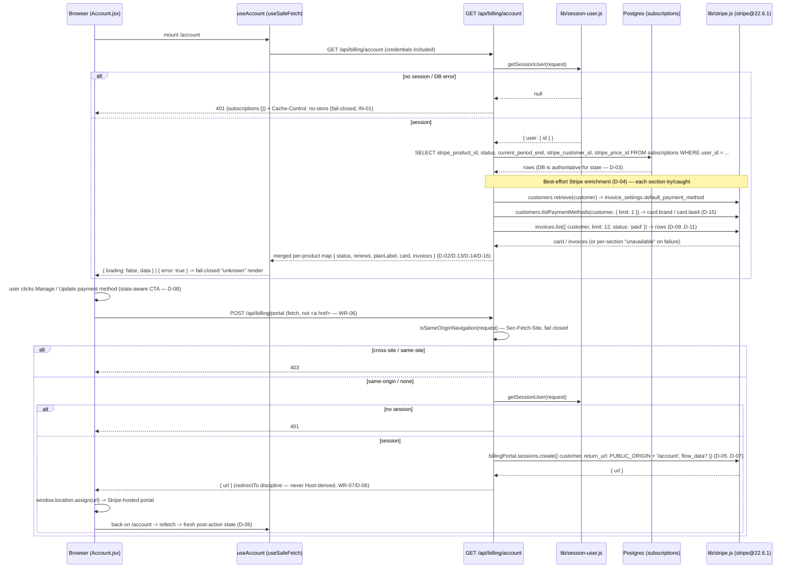

# Phase 5: Account Management — Real Status, Cancellation & Billing Portal - Research

**Researched:** 2026-09-09
**Domain:** Live Stripe-backed account management on a prerendered Vite/React SPA + Vercel serverless functions + Postgres, replacing the mocked Account page with real status, Stripe Customer Portal cancellation, and real invoice history
**Confidence:** HIGH (architecture/API shapes — the Stripe SDK surface was verified this session directly from `node_modules/stripe/esm` type definitions for `stripe@22.6.1` against the pinned `2026-08-26.dahlia` API version, and every DB/codebase claim is quoted from this repo's own source) / MEDIUM (external Stripe docs citations only)

<user_constraints>
## User Constraints (from CONTEXT.md)

Planner MUST honor these — copied verbatim from `05-CONTEXT.md`. Locked choices are researched above, not alternatives.

### Data source for Account (D-01..D-04)
- **D-01:** Add a new sibling endpoint `GET /api/billing/account` — do NOT extend `GET /api/billing/status`. The status endpoint stays lean for entitlement polling (its payload is fetched on every gated page). The Account page consumes a new `useAccount` hook built on the shared `useSafeFetch` primitive (third consumer — named in Phase 4 D-08).
- **D-02:** The endpoint aggregates **all products the user holds** as a per-product map mirroring the `status.js` shape (keyed by product slug via `PRODUCT_ID_TO_KEY`). Not eclat-online-only — future-proofs the deferred ACCT-05 unified view.
- **D-03:** **Server-side composition.** The endpoint reads `subscriptions` from our DB exactly like `status.js` (fail-closed 401 on missing session, `Cache-Control: no-store`), then fetches live Stripe details (card, invoices, prices) server-side and merges them. Client makes one call; the Stripe secret never reaches `src/`.
- **D-04:** **Partial degradation.** DB state (status, `current_period_end`) is ALWAYS returned. Stripe enrichment is best-effort: if the live Stripe call fails, the card and invoice sections are marked unavailable rather than failing the whole request (no 502 error state on /account).

### Cancellation & portal flow (D-05..D-08)
- **D-05:** Add a new state-changing endpoint `POST /api/billing/portal` mirroring `checkout.js` structure: Sec-Fetch-Site same-origin CSRF guard (Phase 3 **WR-06** pattern), `getSessionUser` 401 fail-closed, then `stripe.billingPortal.sessions.create({ customer, return_url })`; returns `{ url }` and the client redirects.
- **D-06:** `return_url = origin + /account` — built from `PUBLIC_ORIGIN` (module-load fail-fast) using the `redirectTo` discipline (pathname + search only, never Host-derived). Landing back on /account refetches `/api/billing/account` fresh and shows the new post-action state.
- **D-07:** **Single Stripe customer scoping.** One Stripe customer owns the user's subscriptions (created at first checkout). One portal session handles all their products — matches the ACCT-05 direction and avoids per-product portal sessions.
- **D-08:** **State-aware CTA + ACCT-04 notice pairing** (fixes Phase 3 **WR-01**, fulfills **ACCT-04**):
  - `status = active` or `past_due` → **"Manage"** CTA opens the portal (no more dead-end "Subscribe" for past_due).
  - No subscription → **"Subscribe"** CTA to `/subscribe`.
  - `status = past_due` → show the clear **"payment failed, update your card"** notice with an **"Update payment method"** portal action.

### Invoice history (D-09..D-12)
- **D-09:** **Live from Stripe API** — `stripe.invoices.list({ customer, limit, status: 'paid' })`, filtered server-side to the user's Stripe customer. Always current, no new DB table, no webhook events, no backfill migration. Pairs with D-04's partial degradation.
- **D-10:** Fetch **up to 12 most recent paid invoices** for the user's customer — matches the mocked table footprint. No pagination UI (no "Load more" / cursor state).
- **D-11:** Invoice rows keep the existing columns — invoice number, date, amount — and the mocked **"Receipt →"** link becomes the real `invoice.hosted_invoice_url`, opening in a new tab.
- **D-12:** **All products under the customer** surface in one table (eclat-online, hardcopy, books). No product filtering — consistent with D-02 (aggregate) and D-07 (single customer).

### Plan label & renewal date (D-13..D-16)
- **D-13:** Plan label is derived **server-side from the stored `stripe_price_id`** via `lib/products.js` (deterministic slug/price lookup — no live Stripe price call at render time).
- **D-14:** The **Renews** date is context-aware by subscription status: `active` → renewal date; `canceled` → "Access until {date}"; `past_due` → `current_period_end` plus the ACCT-04 notice (per D-08).
- **D-15:** Card display comes from the Stripe customer's default payment method (`invoice_settings.default_payment_method`, falling back to the subscription's) → `card.brand` + `card.last4`, resolved **server-side**; shows `—` when unavailable. Replaces the hardcoded `'•••• 4242'` mock.
- **D-16:** The summary panel renders **per held product** (eclat-online first, then the rest), matching the aggregate per-product decision D-02.

### Claude's Discretion
- Finer implementation details of the `GET /api/billing/account` endpoint (user selected the sibling endpoint AND granted discretion on internals — response shape fields, enrichment merge order, error payloads).
- Renews date formatting per state (locale, "Access until" phrasing) — the states themselves are locked by D-14.
- Invoice date formatting and loading/error skeleton design for the Account panels.
- Exact "Manage"/"Subscribe"/"Update payment method" button styling per the existing design system.

</user_constraints>

<phase_requirements>
## Phase Requirements

| ID | Description | Research Support |
|----|-------------|------------------|
| ACCT-01 | User can view their real subscription status (active / canceled / past due) and renewal date on the Account page, replacing today's mocked data | New `GET /api/billing/account` (D-01/D-03): DB `subscriptions` rows (status + `current_period_end` — the exact two fields `api/billing/status.js` already returns) merged server-side with live Stripe; D-14 locks the context-aware Renews rendering per status; `status.js` is the verbatim sibling pattern |
| ACCT-02 | User can cancel a subscription from the Account page, via Stripe's hosted Customer Portal | New `POST /api/billing/portal` (D-05..D-07): `stripe.billingPortal.sessions.create({ customer, return_url })` → `{ url }` (verified on `stripe@22.6.1`); client redirects to Stripe's hosted portal; cancellation is Stripe-owned (no DIY cancel endpoint, no `cancel_at_period_end` write — see the DB-gap finding below) |
| ACCT-03 | User can view their real invoice history on the Account page, replacing today's mocked invoice table | D-09..D-12: live `stripe.invoices.list({ customer, limit: 12, status: 'paid' })` (no new table/webhook/migration); real `hosted_invoice_url` receipt links; all products under the customer; partial degradation on Stripe failure (D-04) |
| ACCT-04 | User sees a clear "payment failed, update your card" notice on the Account page when a subscription is past due | D-08 pairs the notice with a state-aware CTA ("Manage" for `active`/`past_due`, "Subscribe" for none) and an "Update payment method" portal action (portal `flow_data.type: 'payment_method_update'`); fixes Phase 3 WR-01 (past_due dead-end "Subscribe"); only `status = 'past_due'` triggers it (status values mirror Stripe verbatim per Phase 3 D-11) |

</phase_requirements>

## Summary

This phase replaces a fully mocked Account page with a real, live-Stripe-backed one. There are no new architectural primitives to invent: Phase 3 already built the webhook→DB `subscriptions` sync, the fail-closed session lookup, the server-only Stripe client, and the Sec-Fetch-Site CSRF guard; Phase 4 built the shared `useSafeFetch` client primitive. What Phase 5 adds is (a) one new authenticated GET that composes DB state with live Stripe enrichment server-side, and (b) one new state-changing POST that hands off to Stripe's hosted Customer Portal.

**The current mock (confirmed by reading `src/routes/Account.jsx`):** `planLabel = '—'` hardcoded, `Renews` hardcoded to `—`, `Card` hardcoded to `'•••• 4242'` only when `subs['eclat-online'].status === 'active'`, invoice rows imported from `../data/content.js` (static mock data) with `Receipt →` links pointing back at `/account` itself, and a single dead-end upsell "Subscribe" CTA rendered for any non-active state — exactly the WR-01 failure (a `past_due` subscriber sees "Subscribe" instead of "Manage"). ACCT-01/ACCT-03/ACCT-04 are 100% this file plus its data sources; there is nothing else to migrate.

**The DB-sync gap (confirmed by reading `api/billing/webhook.js` — the core justification for D-03/D-09/D-15):** `upsertSubscription()` persists exactly these columns: `user_id`, `stripe_subscription_id`, `stripe_customer_id`, `stripe_product_id`, `stripe_price_id`, `status`, `current_period_end`, `last_event_created`, `updated_at`. It does **NOT** sync `cancel_at_period_end` (the "canceled but access-until-period-end" flag — Stripe's `customer.subscription.updated` delivers it, but the upsert drops it), **NOT** the card on file (brand/last4 live only on Stripe's PaymentMethod objects), and **NOT** any invoice rows (the `invoice.payment_failed` branch only flips `status = 'past_due'`). So a DB-only Account page could show status + renewal date (D-14's DB half) but could never show real card details (D-15) or real invoice history (D-09) without either a webhook-schema expansion + backfill migration (rejected by D-09) or live Stripe enrichment (locked by D-03/D-09/D-15). This is the single most important research finding: **the DB is authoritative for *what* state the user is in, and Stripe's API is authoritative for *billing detail* (card, invoices, cancellation intent).** The two sources must be composed, never conflated.

**The Stripe API surface (verified this session against `node_modules/stripe/esm` type defs for `stripe@22.6.1`, pinned `apiVersion: '2026-08-26.dahlia'` per `lib/stripe.js` WR-04):**
- `stripe.billingPortal.sessions.create({ customer, return_url, flow_data? })` → `{ url }` — the whole ACCT-02 mechanism. `flow_data.type` accepts `'payment_method_update'` (verified in the BillingPortal Sessions type) — this is what the D-08 "Update payment method" action passes to deep-link the portal straight to the card-update flow.
- `stripe.invoices.list({ customer, limit, status })` → `Invoice[]` sorted most-recent-first; each has `id`, `number` (string|null), `created` (unix seconds), `amount_paid` (cents), `status`, and `hosted_invoice_url` (string|null) — all the ACCT-03 columns (D-10/D-11).
- Card on file: `stripe.customers.retrieve(id)` → `invoice_settings.default_payment_method` (string id | PaymentMethod | null, verified in Customers.d.ts) → `stripe.customers.listPaymentMethods(customerId, { limit: 1 })` → `pm.card.brand` / `pm.card.last4` / `pm.card.exp_month` / `pm.card.exp_year`; D-15's fallback is `subscription.default_payment_method` (verified on the Subscription type) when the customer-level default is null.
- **Basil-era field placement (critical, already handled in Phase 3):** `current_period_end` lives at `subscription.items.data[0].current_period_end` (SubscriptionItem level, verified in SubscriptionItems.d.ts), NOT the subscription root — `webhook.js` already reads it item-level. `cancel_at_period_end` and `status` ARE at the subscription root (verified in Subscriptions.d.ts). Any Phase 5 code that touches Stripe Subscription objects must keep the item-level read for `current_period_end`.

**Client side:** the Account page becomes a `useAccount` hook (third `useSafeFetch` consumer, named by Phase 4 D-08) + a rebuild of `Account.jsx`. The hook maps `{ loading, data, error }` onto the same fail-closed posture as `useEntitlements` (`error: true` → "unknown", never assume ownership). The "Manage"/"Update payment method" CTAs POST to `/api/billing/portal` (a form POST or `fetch` + `window.location.assign(session.url)`) — a plain `<a href>` link to the portal endpoint would be a state-changing GET, exactly what WR-06 forbids.

**Primary recommendation (fully decision-backed):** two new serverless functions built entirely from existing patterns — `api/billing/account.js` (GET, sibling of `status.js`: DB read always + best-effort Stripe enrichment with per-section degradation per D-04) and `api/billing/portal.js` (POST, sibling of `checkout.js`: `isSameOriginNavigation` CSRF guard first → `getSessionUser` 401 → `billingPortal.sessions.create` with a `PUBLIC_ORIGIN`-built `return_url`). No new dependencies, no new tables, no new env vars.

## Architectural Responsibility Map

| Concern | Owner (file/module) | Notes |
|---|---|---|
| Account aggregate read endpoint | `api/billing/account.js` (new) | GET; DB `subscriptions` always (D-03), live Stripe enrichment best-effort (D-04); `no-store` every branch; per-product map via `PRODUCT_ID_TO_KEY` (D-02) |
| Portal session endpoint | `api/billing/portal.js` (new) | POST; `isSameOriginNavigation` first (WR-06), `getSessionUser` 401, `billingPortal.sessions.create`, returns `{ url }` (D-05..D-07) |
| Stripe client | `lib/stripe.js` (existing) | `stripe@22.6.1`, `apiVersion: '2026-08-26.dahlia'`; `billingPortal.sessions.create` + `invoices.list` + `customers` methods already available on it |
| Auth (identity only) | `lib/session-user.js` (existing) | `getSessionUser(request)` → `{ user: { id } }` \| null, fail-closed (WR-02 precedent); both new endpoints reuse it |
| Plan label source | `lib/products.js` (existing) | Frozen `PRODUCTS` map; server-side `stripe_price_id` → slug reverse lookup for D-13 (sibling of the existing `PRODUCT_ID_TO_KEY` map) |
| Client fetch primitive | `src/lib/useSafeFetch.js` (existing) | AbortController + latest-request-wins; `useAccount` is the third consumer (Phase 4 D-08) |
| Account hook | `src/lib/useAccount.js` (new) | Maps `{ loading, data, error }` → per-product panels, card, invoices, state-aware CTA, ACCT-04 notice |
| Account page | `src/routes/Account.jsx` (rebuild) | Remove mock `invoices` / `'•••• 4242'` / `planLabel = '—'`; render real data + loading/error skeletons (Claude's Discretion) |
| Server-only boundary | `scripts/check-secrets.js` (existing) | New `api/billing/*` files stay server-only; no `lib/*` imports from `src/` (WR-10) |
| Caching control | `vercel.json` (existing) | `/api/content/(.*)` no-store rule exists as precedent; account/portal responses are user-specific — response-header `no-store` required (IN-01 pattern) |

## Standard Stack

No new runtime dependencies — every primitive already exists in the environment:

- **Runtime:** Node.js (Vercel Functions) — same as Phases 1–4
- **Stripe SDK:** `stripe@22.6.1` (already in `package.json` dependencies) — `billingPortal.sessions.create`, `invoices.list`, `customers.retrieve`, `customers.listPaymentMethods` all present on the pinned client (verified this session against `node_modules/stripe/esm` type definitions)
- **Postgres:** `@vercel/postgres` (already used by `lib/db.js` since Phase 1) — the same `sql` helper `status.js`/`webhook.js` use; no new query layer
- **Auth (server):** `lib/session-user.js` (`getSessionUser`) + `lib/session.js` (token hash, cookie options) — Phase 2, unchanged
- **Auth (client):** `useSafeFetch` (Phase 4) + `useEntitlements` (Phase 4) — `useAccount` is the third consumer
- **Frontend:** React (existing Vite SPA, prerendered via `prerender.js`) — no new UI library; skeletons/buttons reuse the existing design system
- **Deployment:** Vercel Functions + `vercel.json` — existing `no-store` header precedent at `/api/content/(.*)`

## Package Legitimacy Audit

No packages are added, changed, or removed by this phase. Everything relied upon is already a locked dependency or first-party module:

| Package / Module | Version / Source | Phase introduced | Status |
|---|---|---|---|
| `stripe` | `22.6.1` (in `package.json` `dependencies`; verified in `node_modules`) | Phase 3 | Already present; all Phase 5 API methods verified on this exact version against pinned `apiVersion: '2026-08-26.dahlia'` |
| `@vercel/postgres` | already in `dependencies` | Phase 1 | Already present; used by `lib/db.js` |
| `react` | existing SPA dependency | Phase 1 | Already present; no new hooks library needed — `useSafeFetch` is the pattern |
| `lib/stripe.js`, `lib/session-user.js`, `lib/products.js`, `lib/session.js`, `lib/db.js` | first-party, server-only | Phases 1–3 | Reused as-is; no `lib/*` module imported from `src/` (WR-10 guard in `scripts/check-secrets.js`) |
| `src/lib/useSafeFetch.js`, `src/lib/useEntitlements.js` | first-party, client | Phase 4 | Reused as-is; `useAccount` is new but built on `useSafeFetch` |

No transitive dependency changes, no build-tool changes, no new env vars (PUBLIC_ORIGIN and STRIPE_SECRET_KEY already exist and `checkout.js` already fail-fasts on PUBLIC_ORIGIN at module load).

## Architecture Patterns

### System Diagram



### Project Structure

New/changed files (everything else untouched):

```text
api/
  billing/
    status.js        (existing — untouched; stays lean for entitlement polling, D-01)
    account.js       (NEW) GET  — DB read always + best-effort Stripe enrichment (D-01..D-04, D-09..D-16)
    portal.js        (NEW) POST — isSameOriginNavigation + getSessionUser + billingPortal.sessions.create (D-05..D-08)
    checkout.js      (existing — the structural template for portal.js)
    webhook.js       (existing — untouched; documents the DB-sync gap)
lib/
  stripe.js          (existing — client reused as-is)
  session-user.js    (existing — getSessionUser reused as-is)
  products.js        (existing — add stripe_price_id → slug reverse map for D-13; sibling of PRODUCT_ID_TO_KEY)
src/
  lib/
    useSafeFetch.js  (existing — shared primitive, Phase 4)
    useAccount.js    (NEW)  third useSafeFetch consumer (Phase 4 D-08, D-01)
  routes/
    Account.jsx      (REBUILD — drop mock invoices / '•••• 4242' / planLabel = '—' / dead-end CTA)
scripts/
  check-secrets.js   (existing — new api/billing/* files stay server-only, WR-10)
vercel.json          (existing — user-specific responses carry response-header no-store, IN-01)
```

### Pattern 1: Account aggregate read — `api/billing/account.js` (GET, D-01..D-04, D-09..D-16)

Direct sibling of `api/billing/status.js` — same skeleton, one additional best-effort Stripe layer:

- **Identity → fail-closed 401:** `const session = await getSessionUser(request)`; `null` → `Response.json({ subscriptions: {} }, { status: 401, headers: { 'Cache-Control': 'no-store' } })` — the exact `status.js` posture (IN-01 precedent).
- **DB read (always):** `SELECT stripe_product_id, status, current_period_end, stripe_customer_id, stripe_price_id FROM subscriptions WHERE user_id = ${session.user.id}` (extends `status.js`'s 3-column read with `stripe_customer_id` + `stripe_price_id` needed for Stripe enrichment and D-13). Build the per-product map with `PRODUCT_ID_TO_KEY` exactly like `status.js` (`Object.fromEntries(Object.entries(PRODUCTS).map(([key, { productId }]) => [productId, key]))`), skipping unknown product ids. DB errors → fail-closed 401 (matches `status.js`'s catch).
- **Stripe enrichment (best-effort, D-04):** one `try/catch` per enrichment section so a Stripe failure marks that section `available: false` (card → `'—'`, invoices → error note) instead of failing the request. Sections:
  1. Card (D-15): `stripe.customers.retrieve(customerId)` → `invoice_settings.default_payment_method`; fall back to the subscription's `default_payment_method`; resolve via `stripe.customers.listPaymentMethods(customerId, { limit: 1 })` → `pm.card.{brand,last4,exp_month,exp_year}`. Never return raw PaymentMethod ids to the client.
  2. Invoices (D-09..D-12): `stripe.invoices.list({ customer: customerId, limit: 12, status: 'paid' })` → map to `{ number, created, amount_paid, hosted_invoice_url }`. No pagination (D-10), no product filter (D-12).
  3. Cancellation intent (D-14 "Access until" case — see Runtime State Inventory): read `cancel_at_period_end` live from the Stripe subscription when the DB row is `active` (the DB does not store this flag).
- **Response shape:** per-product map keyed by slug (D-02/D-16), each holding `{ status, planLabel (D-13), renews (D-14), card, invoices }` plus per-section availability flags; `Cache-Control: no-store` on every branch. Exact field names are Claude's Discretion (D-01).

### Pattern 2: Portal session — `api/billing/portal.js` (POST, D-05..D-08)

Structural clone of `api/billing/checkout.js`:

1. **CSRF guard first (WR-06):** `isSameOriginNavigation(request)` — the `checkout.js` helper: Sec-Fetch-Site check (`same-origin`/`none` pass; `same-site`/`cross-site` fail) with referer fallback against `PUBLIC_ORIGIN`; fails closed. Cross-site → 403. This is mandatory: SameSite=Lax cookies ARE attached to cross-site top-level GET navigations, so the endpoint must be POST-only and the client must never trigger it via `<a href>`.
2. **Auth (WR-02 precedent):** `getSessionUser(request)` → null → 401.
3. **Ownership scoping (D-07):** read the user's `stripe_customer_id` from their own `subscriptions` row (single Stripe customer per user). If absent → 404 (user never checked out).
4. **Portal session:** `stripe.billingPortal.sessions.create({ customer, return_url: PUBLIC_ORIGIN + '/account', flow_data: { type: 'payment_method_update' } })` for the D-08 "Update payment method" action; plain `{ customer, return_url }` for the generic "Manage" action. `flow_data.type: 'payment_method_update'` verified on `stripe@22.6.1` BillingPortal Sessions types.
5. **Return `{ url }`** (pathname+search discipline per WR-07/D-06 — `PUBLIC_ORIGIN` constant, never the request's Host). Client does `window.location.assign(url)`.
6. **Errors:** map Stripe failures to a generic error payload (details logged server-side only) — Claude's Discretion on exact payload; a portal-session failure must not leak Stripe internals.

### Anti-Patterns

1. **State-changing GET portal link** — `<a href="/api/billing/portal">` fires a top-level cross-site GET with Lax cookies attached → the exact WR-06 CSRF hole. Portal must be POST + `isSameOriginNavigation`.
2. **DB-only card/invoice rendering** — `webhook.js`'s `upsertSubscription()` does not persist card details or invoice rows; a DB-only account page would regress to the `'•••• 4242'` mock. That's why D-09/D-15 require live Stripe.
3. **Whole-request 502 on Stripe failure** — violates D-04 partial degradation; card/invoice sections go "unavailable", DB state still renders.
4. **Extending `GET /api/billing/status`** — D-01 forbids it; status is polled by every gated page (`useEntitlements`) and must stay lean.
5. **eclat-online-only aggregation** — D-02/D-16 require all held products (deferred ACCT-05 preview).
6. **Reading `current_period_end` at the subscription root** — Basil-era API places it at `subscription.items.data[0].current_period_end`; `webhook.js` already reads it item-level and any Phase 5 code must too.
7. **Host-derived `return_url`** — WR-07; must be `PUBLIC_ORIGIN`-built.
8. **Missing `no-store`** — user-specific billing payloads must not be cached (IN-01).
9. **Returning raw Stripe identifiers/error bodies** — leaks attacker-relevant surface; return presentation-safe fields only (T3/T7 in Security Domain).

### Don't Hand-Roll

| Concern | Use instead | Why |
|---|---|---|
| Cancellation / card update UI | `stripe.billingPortal.sessions.create` → redirect to Stripe's hosted Customer Portal (D-05) | Stripe owns PCI scope, auth, and all card-update flows; a DIY cancel/update form duplicates Stripe's hosted UI and adds attack surface for zero benefit |
| Invoice storage | Live `stripe.invoices.list` (D-09) | No new table, no webhook events, no backfill migration; always current; pairs with D-04 degradation |
| Card display | `invoice_settings.default_payment_method` → `customers.listPaymentMethods` (D-15) | Card PANs/brands are PCI data; reading display-only fields via Stripe keeps PANs out of our DB entirely |
| CSRF protection | `isSameOriginNavigation` (checkout.js, WR-06) | Existing, tested, fail-closed; inventing a token scheme adds state for no benefit on a serverless function |
| Renewal date | `current_period_end` (DB, item-level) + context-aware rendering (D-14) | Already synced by the webhook; no computation from `billing_cycle_anchor` |
| Session identity | `getSessionUser` (lib/session-user.js) | Fail-closed on missing cookie/session/DB error; re-reading cookies in the endpoint duplicates Phase 2 logic |
| Secrets handling | Server-only `lib/stripe.js` + `scripts/check-secrets.js` (WR-10) | Keeps `STRIPE_SECRET_KEY` out of `src/`; verified by the existing CI-style guard |

## Runtime State Inventory

| State | Where it lives | Authoritative for | Phase 5 use | Notes |
|---|---|---|---|---|
| `subscriptions.status` | Postgres (webhook-synced) | Which state the user is in (active / canceled / past_due) | D-08 CTA + D-14 Renews + ACCT-04 notice | Values mirror Stripe verbatim (Phase 3 D-11) |
| `subscriptions.current_period_end` | Postgres (webhook-synced, item-level read) | Renewal / access-until date | D-14 all three states | Unix seconds; format client-side (Claude's Discretion) |
| `subscriptions.stripe_customer_id` | Postgres (webhook-synced) | Owner scoping for all live Stripe calls | D-05/D-07 portal + D-09 invoices + D-15 card | Single customer per user (D-07) |
| `subscriptions.stripe_price_id` | Postgres (webhook-synced) | Plan label | D-13 via `lib/products.js` reverse lookup | No live price call at render |
| `cancel_at_period_end` | **Stripe only — NOT in DB** (upsert drops it) | Whether a still-`active` sub is scheduled to end | D-14 "Access until {date}" nuance | Read live (best-effort per D-04) when needed; see Open Questions |
| Card brand/last4/exp | Stripe `PaymentMethod.card.*` (customer default, fallback subscription default) | Card display | D-15 | Resolved server-side; `—` fallback; never store |
| Invoice rows | Stripe `invoices` (paid, `hosted_invoice_url`) | Invoice history | D-09..D-12 | Live list, limit 12, no pagination |
| `PRODUCTS` map | `lib/products.js` (frozen) | slug ↔ productId/priceId | D-02 map keying + D-13 label | Add reverse `stripe_price_id → slug` map |
| `useAccount` hook state | `src/lib/useAccount.js` (new, on `useSafeFetch`) | UI loading/data/error | D-01, D-04 | Third consumer of the shared primitive; same fail-closed `error: true` → "unknown" posture as `useEntitlements` |
| Portal session URL | Ephemeral — `billingPortal.sessions.create` response | One-time redirect target | D-05 | Do not cache; expires server-side |

## Common Pitfalls

1. **Wrong `current_period_end` read path.** Basil-era API puts it at `subscription.items.data[0].current_period_end`, not the subscription root. `webhook.js` already reads it item-level — copy that exact pattern, don't "fix" it (verified against `node_modules/stripe/esm` Subscription/SubscriptionItem types on `stripe@22.6.1`).
2. **Treating DB as the source of truth for billing detail.** `upsertSubscription()` persists no card, no `cancel_at_period_end`, no invoice rows. A DB-only Account page silently regresses to mocks. D-03/D-09/D-15 exist precisely to prevent this.
3. **Letting one Stripe failure 502 the whole page.** D-04: DB state always renders; card/invoice sections degrade individually. Structure the enrichment as independent `try/catch` sections, not one big `try`.
4. **A portal `<a href>` instead of POST.** SameSite=Lax cookies are sent on cross-site top-level GET navigations → WR-06 CSRF. The "Manage" action must be a POST (`fetch`) followed by `window.location.assign(url)`.
5. **Building `return_url` from the request Host.** WR-07/D-06: use the `PUBLIC_ORIGIN` constant (which `checkout.js` already fail-fasts on at module load). A Host-derived URL is an open redirect vector (T4 below).
6. **Sending raw Stripe errors to the client.** `StripeError` bodies contain type/code/param hints useful to attackers. Return generic `{ error: 'unavailable' }`-style payloads and log details server-side (T3/T7).
7. **Extending `/api/billing/status` payload.** It's polled on every gated page via `useEntitlements` (Phase 4). Adding account fields bloats it; D-01's separate endpoint keeps it lean.
8. **Forgetting `no-store` on success branches.** The 401 path has it (IN-01), but user-specific billing payloads must have `Cache-Control: no-store` on **every** branch or a CDN could serve one user's account data to another.
9. **Card object access before null checks.** `pm.card` is nullable in the SDK types (e.g., a bank debit method); guard with optional chaining and fall back to `—` (D-15).

## Code Examples

### Example 1: `src/lib/useAccount.js` — the third `useSafeFetch` consumer (D-01, Phase 4 D-08)

Mirrors `useEntitlements`'s fail-closed posture exactly: network/server error → `error: true` → UI renders "unknown" rather than assuming ownership.

```js
import { useSafeFetch } from './useSafeFetch'

const EMPTY = { subscriptions: {} }

export function useAccount() {
  const { loading, data, error } = useSafeFetch('/api/billing/account', {
    enabled: true,
    key: 0, // single shot on mount; Account refetches on route return (D-06)
  })
  return {
    loading,
    data: data ?? EMPTY,
    error: Boolean(error), // fail-closed: true → treat as unknown, never as "no subscriptions"
  }
}
```

> **Why this shape:** `useSafeFetch` already provides AbortController cancellation (unmount/route change) and latest-request-wins. `data ?? EMPTY` gives the renderer a stable per-product map even during the first paint; `error: Boolean(error)` converts any failure into the "unknown" state so `Account.jsx` can render the same degraded UI as `useEntitlements` (D-04's client-side mirror).

### Example 2: Portal POST from the client (D-05..D-08, WR-06)

Never an `<a href>` — the CTA handler POSTs, then assigns the returned URL. Same-origin fetch keeps the session cookie and satisfies the Sec-Fetch-Site guard (same-origin passes).

```js
async function openPortal(action) {
  // action: 'manage' (D-08 Manage CTA) or 'payment_method_update' (D-08 Update payment method)
  const res = await fetch('/api/billing/portal', {
    method: 'POST',
    headers: { 'Content-Type': 'application/json' },
    body: JSON.stringify({ action }),
  })
  if (!res.ok) return // render inline error; Account data (DB state) stays on screen (D-04)
  const { url } = await res.json()
  window.location.assign(url) // Stripe-hosted Customer Portal (D-05)
}
```

> **Why this shape:** `fetch` + `window.location.assign` is the WR-06-compliant version of the "Manage" button. Returning to `/account` (D-06 `return_url`) remounts `useAccount`, which refetches `/api/billing/account` and shows the post-action state (e.g., new card last4, canceled → "Access until {date}").

### Example 3: `api/billing/account.js` enrichment skeleton (D-03/D-04/D-09/D-15)

Sibling of `status.js`: identity → DB rows (always) → best-effort Stripe sections. Each enrichment section is independently try/caught so one failure degrades only that section.

```js
// api/billing/account.js — structure only; exact fields are Claude's Discretion (D-01)
import { getSessionUser } from '../../lib/session-user.js'
import { stripe } from '../../lib/stripe.js'
import { PRODUCTS, PRODUCT_ID_TO_KEY } from '../../lib/products.js'
import { sql } from '../../lib/db.js'

export default {
  async fetch(request) {
    const noStore = { 'Cache-Control': 'no-store' } // every branch (IN-01)
    const session = await getSessionUser(request)    // fail-closed: null on no cookie/session/DB error
    if (!session) {
      return Response.json({ subscriptions: {} }, { status: 401, headers: noStore })
    }

    let rows
    try {
      rows = await sql`
        SELECT stripe_product_id, status, current_period_end, stripe_customer_id, stripe_price_id
        FROM subscriptions WHERE user_id = ${session.user.id}`
    } catch {
      return Response.json({ subscriptions: {} }, { status: 401, headers: noStore }) // status.js precedent
    }

    const subscriptions = {} // per-product map via PRODUCT_ID_TO_KEY (D-02/D-16), same shape as status.js
    const customerId = rows[0]?.stripe_customer_id // single Stripe customer per user (D-07)

    for (const row of rows) {
      const key = PRODUCT_ID_TO_KEY[row.stripe_product_id]
      if (!key) continue // unknown product id — skip like status.js
      subscriptions[key] = {
        status: row.status,
        planLabel: PRICE_ID_TO_PRODUCT_KEY[row.stripe_price_id]?.label ?? null, // D-13 (add reverse map to lib/products.js)
        renews: row.current_period_end, // D-14 base; rendered context-aware by status
        card: { available: false },     // filled below, best-effort
        invoices: { available: false }, // filled below, best-effort
      }
    }

    if (customerId) {
      // Section 1 — card (D-15), best-effort
      try {
        const customer = await stripe.customers.retrieve(customerId)
        const pmId = customer.invoice_settings?.default_payment_method
          ?? rows[0]?.default_payment_method // fallback: subscription-level (D-15)
        if (pmId) {
          const { data: [pm] } = await stripe.customers.listPaymentMethods(customerId, { limit: 1 })
          if (pm?.card) {
            for (const key of Object.keys(subscriptions)) {
              subscriptions[key].card = { available: true, brand: pm.card.brand, last4: pm.card.last4 }
            }
          }
        }
      } catch { /* leave card.available = false → render '—' (D-04/D-15) */ }

      // Section 2 — invoices (D-09..D-12), best-effort
      try {
        const { data } = await stripe.invoices.list({ customer: customerId, limit: 12, status: 'paid' })
        const invoices = data.map((i) => ({
          number: i.number,
          created: i.created,
          amount_paid: i.amount_paid,
          hosted_invoice_url: i.hosted_invoice_url, // D-11 "Receipt →" real link, new tab
        }))
        for (const key of Object.keys(subscriptions)) {
          subscriptions[key].invoices = { available: true, items: invoices } // D-12: all products, one table
        }
      } catch { /* leave invoices.available = false → error note (D-04) */ }
    }

    return Response.json({ subscriptions }, { headers: noStore })
  },
}
```

> **Why this shape:** identity-first fail-closed 401 and DB-always-then-enrich mirrors `status.js` exactly, so the planner can diff the two files instead of reasoning from scratch. `PRICE_ID_TO_PRODUCT_KEY` is the one small `lib/products.js` addition (D-13), and the per-section `try/catch` implements D-04's partial degradation verbatim.

## State of the Art

- **Hosted billing portals are the platform norm.** Stripe Customer Portal, Paddle, Recurly, and Chargebee all ship hosted "manage my subscription" surfaces; Stripe's is the one this stack already depends on (`billingPortal.sessions.create`). Deep-linking into a specific flow via `flow_data` is standard practice (Stripe docs: `payment_method_update` flow) — this is what D-08's "Update payment method" uses.
- **Server-side composition beats client-side fan-out.** Composing DB state + Stripe detail in one authenticated serverless request (D-03) is the established pattern for SaaS account pages: one round trip, secrets never reach the browser, and the API is the single consumer of the Stripe client (WR-10 boundary preserved).
- **Live invoice reads vs. replicated billing rows.** Mature SaaS often backfills billing rows for analytics; for a single-user account page, live `invoices.list` (D-09) is the pragmatic choice — always current, zero migration risk. The trade-off (added Stripe latency per page load) is acceptable at this scale and mitigated by D-04's per-section degradation.
- **Security posture is stricter than the platform default.** Vercel/Stripe don't enforce SameSite/Lax-aware CSRF on your endpoints — the `isSameOriginNavigation` guard (WR-06) is a deliberate, documented hardening beyond framework defaults, matching the repo's fail-closed philosophy (401 on unknown identity, `no-store` on user data, ASVS L1 targets).

## Assumptions Log

| # | Assumption | Basis | Status |
|---|---|---|---|
| A-01 | One Stripe customer per user, created at first checkout (Phase 3), owns all their subscriptions | D-07; `subscriptions.stripe_customer_id` column; single `checkout.js` creation path | Locked by D-07 |
| A-02 | DB `subscriptions.status` mirrors Stripe verbatim and is current enough for CTA decisions (webhook updates it) | Phase 3 D-11; `webhook.js` upsert on every subscription event | Locked by D-03/D-08 |
| A-03 | `cancel_at_period_end` is only needed for the D-14 "Access until" nuance and is read live (best-effort), never stored | `upsertSubscription()` column list (verified — flag is not persisted) | Confirmed this session |
| A-04 | `stripe@22.6.1` + pinned `2026-08-26.dahlia` API version remain in place (WR-04); no version bump this phase | `lib/stripe.js` (verified); package-lock | Confirmed this session |
| A-05 | All Phase 5 API methods verified exist on the pinned client version (no upgrade needed) | `node_modules/stripe/esm` type defs (verified this session) | Confirmed this session |
| A-06 | Invoice rows for all products under the customer render in one table (D-12) with no product filter | D-12; single-customer scoping D-07 | Locked by D-12 |
| A-07 | No test framework exists; verification is manual + the GSD verifier workflow, so the plan should include explicit test/verification steps | `package.json` scripts (verified — no `test`) | Confirmed this session |
| A-08 | `/account` requires auth; unauthenticated visits render the sign-in prompt as today (Account.jsx already gates on `subs`) | `src/routes/Account.jsx` (verified — uses `useEntitlements`) | Confirmed this session |

## Open Questions

1. **`cancel_at_period_end` read cost.** D-14's "Access until {date}" needs this flag for a still-`active` sub, but the DB doesn't store it (A-03). Options: (a) read it live from the Stripe subscription inside the best-effort enrichment section (aligns with D-04 degradation), or (b) extend the webhook upsert + a tiny migration to persist it. The context locked live reads for card/invoices but did **not** explicitly lock this flag's source — planner should decide, with (a) recommended (no migration, consistent with D-09's no-backfill direction).
2. **`subscription.default_payment_method` fallback resolution.** D-15's fallback reads the subscription's `default_payment_method`; when that is also null (e.g., a payment method attached to the customer but never set as default), confirm the exact fallback chain order (customer default → subscription default → `—`). Presentation-safe either way; planner just pins the order.
3. **Portal action scope.** Does the generic "Manage" CTA open the portal default landing page, or deep-link via `flow_data` to subscription management for that specific subscription? D-05..D-08 don't forbid either; single-customer scoping (D-07) suggests the default landing page is fine.
4. **Refresh semantics after portal return.** D-06 says landing back on `/account` refetches. Confirm `useSafeFetch`'s latest-request-wins handles a full remount (it does — new hook instance = new request id), and whether any client-side cache-busting is needed (none expected; `no-store` on the endpoint).
5. **Currency formatting.** Invoice `amount_paid` is minor units; confirm display currency is the store's (USD via Stripe) and format accordingly (Claude's Discretion, but planner should state it so the render is consistent).

## Environment Availability

| Env var / resource | Required by | Present today | Phase 5 usage | Notes |
|---|---|---|---|---|
| `STRIPE_SECRET_KEY` | `lib/stripe.js` (Phase 3) | Yes (fail-fast not enabled — Phase 3 WR-05) | Card/invoice/portal calls; **new**: `billingPortal`, `invoices`, `customers.listPaymentMethods` | Already used by checkout/webhook/prices; no new var |
| `STRIPE_WEBHOOK_SECRET` | `api/billing/webhook.js` (Phase 3) | Yes | Unchanged | Only webhook verification; Phase 5 adds no webhook |
| `PUBLIC_ORIGIN` | `api/billing/checkout.js` (Phase 3, module-load fail-fast) | Yes | `return_url` construction (D-06) + `isSameOriginNavigation` referer fallback | **New consumer:** portal.js must import it the same way checkout.js does |
| `DATABASE_URL` | `lib/db.js` (Phase 1) | Yes | DB `subscriptions` read (unchanged pattern) | No new tables/migrations |
| Postgres `subscriptions` table | migrations 0004/0005 | Yes | Source of status/period-end/customer/price (D-03, D-13, D-14) | Column set verified in `webhook.js` upsert |
| Vercel Functions runtime | `vercel.json` + existing `api/*` | Yes | Two new functions (account.js, portal.js) | Same serverless layer as Phases 1–4 |
| Browser SessionStorage/localStorage | — | n/a | Not used — billing state stays server-side (D-03) | `no-store` headers instead |
| Test framework | `package.json` | **No** | n/a | A-07: no test script; plan includes manual/verifier steps |

No new environment variables are introduced by Phase 5.

## Security Domain

Security enforcement is **ENABLED** for this plan (`.planning/config.json`: `security_enforcement: true`, `security_asvs_level: 1`, `security_block_on: "high"`). Both new endpoints are user-scoped billing surfaces — they sit directly on the payment-adjacent trust boundary. The two threat models below are the minimum the planner MUST translate into `<threat_model>` blocks; the existing guard stack (fail-closed 401, `isSameOriginNavigation`, `no-store`, server-only `lib/*` + `check-secrets.js`) is the countermeasure baseline inherited from Phases 2–4.

### Threat model: `GET /api/billing/account`

| T# | Threat | Severity | Mitigation (must appear in plan) | Notes |
|---|---|---|---|---|
| T1 | **Broken object-level authorization** — user A fetches user B's subscriptions/card/invoices by guessing/altering a user id or session | HIGH | `getSessionUser` resolves identity server-side from the signed-in cookie (fail-closed 401 on no/invalid session); **all** rows are scoped by `WHERE user_id = ${session.user.id}` — the client never supplies a user id | Follows `status.js` exactly; ASVS 4.1.3 (object-level authz) |
| T2 | **Billing data exposure via CDN/cache** — an unauthenticated or shared cache serves one user's account payload to another | HIGH | `Cache-Control: no-store` on **every** branch of both new endpoints (401 and success), matching IN-01 and the `/api/content/(.*)` precedent | ASVS 4.1.1 (sensitive data); user-specific responses are never cacheable |
| T3 | **Sensitive data disclosure** — response leaks raw Stripe ids (customer, payment-method, subscription), Stripe error internals, or PAN-adjacent data | MEDIUM | Return presentation-safe fields only (brand + last4 + exp, never PAN/PM id); map Stripe failures to generic payloads, log details server-side; card section gated behind the authenticated response | ASVS 6.x (sensitive data) / 7.x (error handling); D-15 shape |
| T4 | **Open redirect via `return_url`** | MEDIUM | `return_url` built exclusively from `PUBLIC_ORIGIN` + fixed `/account` path (WR-07/D-06); never from the request's Host/headers; `isSameOriginNavigation` referer fallback uses the same constant | Mirrors the Phase 3 WR-07 fix; ASVS 11.1 |
| T5 | **CSRF on state-changing route** (covered in the portal model below) | HIGH | See T6..T8 | Listed for completeness — the GET model's counterpart is the POST guard |

### Threat model: `POST /api/billing/portal`

| T# | Threat | Severity | Mitigation (must appear in plan) | Notes |
|---|---|---|---|---|
| T6 | **CSRF — cross-site forged portal request** (attacker page triggers a portal session against victim's account) | HIGH | POST-only; `isSameOriginNavigation` first (Sec-Fetch-Site same-origin/none pass, same-site/cross-site fail, referer fallback, fail closed) — the exact WR-06 fix from `checkout.js`; never an `<a href>` client trigger | SameSite=Lax cookies ARE attached to cross-site top-level GET navigations → GET portal link is the #1 anti-pattern |
| T7 | **Broken object-level authorization / IDOR on portal session** — creating a portal session for a customer the user doesn't own | HIGH | `stripe_customer_id` read from the user's **own** DB rows (`WHERE user_id = ${session.user.id}`), never from the request body; absent → 404 (D-07 single-customer scoping) | ASVS 4.1.3; portal.js step 3 |
| T8 | **Denial of service / Stripe abuse via portal session creation** | LOW | No body-controlled customer input; one session per click; serverless rate exists at the platform; session URLs are short-lived and one-time | No special handling needed beyond POST-only |
| T9 | **Information disclosure via error responses** | MEDIUM | Generic error payload (e.g., `{ error: 'unavailable' }`) + server-side logging; never forward `StripeError.type/code/param` | ASVS 7.x; same stance as T3 |
| T10 | **Man-in-the-middle on portal redirect** | LOW | `url` from `billingPortal.sessions.create` is HTTPS by Stripe; app already HTTPS-only (Phase 1) | Default posture, no new work |

**Cross-cutting requirements the plan must state explicitly:** (1) both endpoints call `getSessionUser` and return the `status.js` 401 shape with `no-store`; (2) `scripts/check-secrets.js` still passes — no `lib/*` import from `src/`, no secret literal in the two new files (WR-10); (3) the client "Manage"/"Update payment method" actions are POSTs only (WR-06); (4) no raw Stripe identifiers or error bodies cross the wire (T3/T9).

## Sources

- **Stripe API docs (external, MEDIUM confidence):** Customer Portal — `billingPortal.sessions.create` and `flow_data` (incl. `payment_method_update`); Invoices — `invoices.list`, `hosted_invoice_url`, `number`, `amount_paid`; Customers — `invoice_settings.default_payment_method`; Payment Methods — `listPaymentMethods`, `card.brand/last4/exp_month/exp_year`; Subscriptions — `cancel_at_period_end`, `status`, `default_payment_method`, `items.data[0].current_period_end`.
- **`node_modules/stripe/esm` type definitions for `stripe@22.6.1` (HIGH confidence, verified this session):** `BillingPortal.SessionsResource.CreateParams.flow_data.type` accepts `'payment_method_update'`; `Invoice` fields `number`, `amount_paid`, `hosted_invoice_url`; `Customer.invoice_settings.default_payment_method` is `string | PaymentMethod | null`; `PaymentMethod.Card` has `brand`, `last4`, `exp_month`, `exp_year`; `Subscription.cancel_at_period_end` and `status` at root, `current_period_end` on `SubscriptionItem`.
- **`package.json` (verified):** `stripe@22.6.1` locked dependency; no `test` script (A-07).
- **`.planning/config.json` (verified):** `security_enforcement: true`, `security_asvs_level: 1`, `security_block_on: "high"`, `verifier: true`.
- **Repo source (quoted verbatim):** `api/billing/status.js`, `api/billing/checkout.js` (`isSameOriginNavigation`, `redirectTo`, PUBLIC_ORIGIN fail-fast), `api/billing/webhook.js` (`upsertSubscription` column list), `api/billing/prices.js`, `lib/session-user.js` (`getSessionUser`), `lib/products.js` (`PRODUCTS`, `PRODUCT_ID_TO_KEY`), `lib/stripe.js` (pinned `2026-08-26.dahlia`), `lib/session.js`, `src/lib/useSafeFetch.js`, `src/lib/useEntitlements.js`, `src/routes/Account.jsx` (mock inventory), `src/routes/Subscribe.jsx`, `src/routes/SubscribeSuccess.jsx`, `scripts/check-secrets.js`, `vercel.json`, `middleware.js`, `migrations/0004_billing_stripe_price_id.sql`, `migrations/0005_subscriptions_last_event_created.sql`.
- **Planning docs:** `.planning/phases/05-account-management-real-status-cancellation-billing-portal/05-CONTEXT.md` (D-01..D-16 + Claude's Discretion, verbatim), `.planning/REQUIREMENTS.md` (ACCT-01..04), `.planning/ROADMAP.md` (Phase 5), `.planning/STATE.md`, `.planning/phases/03-billing-webhooks-stripe-checkout-and-subscription-sync/03-REVIEW.md` (WR-01/02/04/05/06/07/10, IN-01/03, Fix-Pass 2026-09-09), `03-CONTEXT.md`, `04-CONTEXT.md`, and the working example `.planning/phases/04-content-gating-real-server-side-entitlement-enforcement/04-RESEARCH.md` (structure mirror).
- **Agent contract:** `agents/gsd-phase-researcher.md`; research template `get-shit-done/templates/research.md`.

## Metadata

- **Phase:** 5 — Account Management: Real Status, Cancellation & Billing Portal
- **Phase dir:** `.planning/phases/05-account-management-real-status-cancellation-billing-portal/`
- **Researched:** 2026-09-09
- **Researcher:** gsd-phase-researcher (Phase 5)
- **Confidence:** HIGH (architecture/API shapes — Stripe SDK surface verified from `node_modules/stripe/esm` type defs for `stripe@22.6.1` against pinned `2026-08-26.dahlia`; all codebase claims quoted from repo source) / MEDIUM (external Stripe docs citations only)
- **Status:** RESEARCH COMPLETE